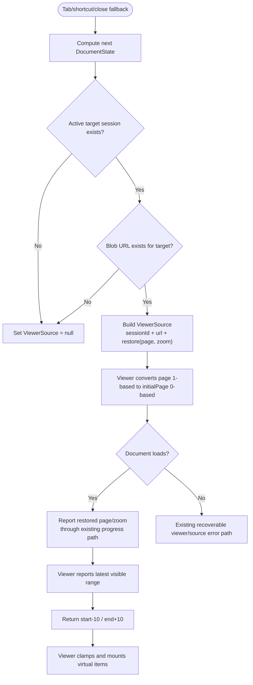
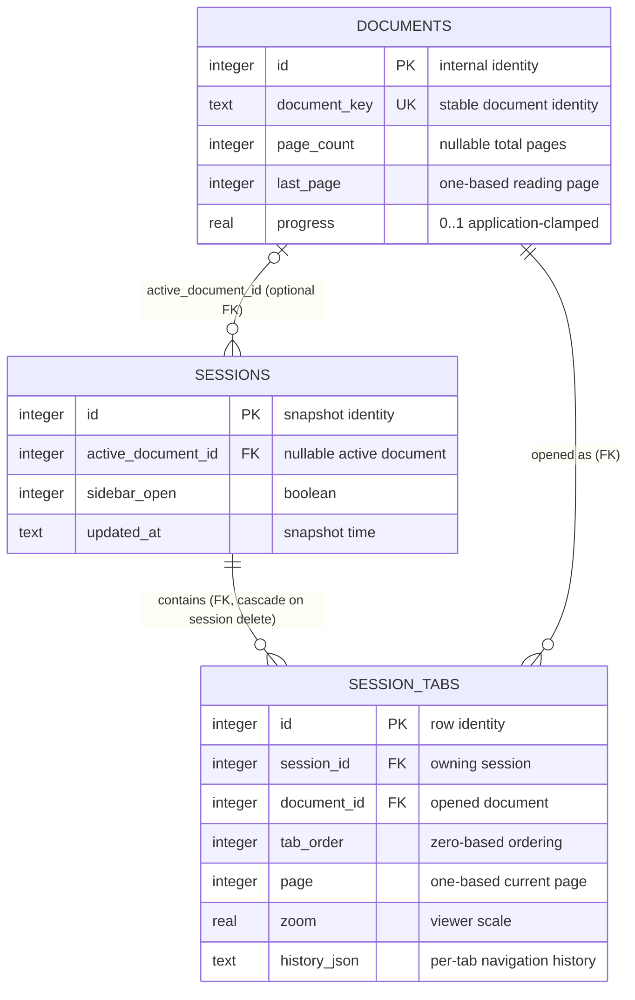

# SmartReader Tab 阅读进度恢复与动态页面渲染窗口 Spec

| Field | Value |
| --- | --- |
| Document | `2026-08-17-16-40-reader-progress-render-window.md` |
| Template Version | `2` |
| Status | `Review` |
| Type | `Bugfix / Performance` |
| Complexity | `Complex` |
| Complexity Drivers | Tab 激活、Viewer 重载、进度持久化和虚拟页面渲染窗口共享页码语义；错误初始页会反向覆盖运行时与 SQLite 进度；页面窗口同时影响连续阅读流畅度与大 PDF 内存占用 |
| Created | `2026-08-17 16:40 CST` |
| Updated | `2026-08-17 16:40 CST` |
| Owner | User |
| Repository | `SmartReader` |
| Scope | React 文档会话激活、ViewerSource 初始位置、PdfViewerBridge 页面渲染范围及相关测试；现有进度持久化只做兼容性约束 |
| Source Requirement | 2026-08-17 用户要求：从上方 Tab 回到文档后继续上次阅读页，而不是第一页；按当前页缓存前后各十页，并在读到缓存第八页时继续加载后续页面，形成动态窗口 |
| Baseline Revision | `main` @ `84ac5c55e53124928332dddaf39f11e3ef6e26c0`；2026-08-17 16:40 CST 干净工作区 |
| Amends | [SmartReader Reading Progress Refresh Design](../../superpowers/specs/2026-07-06-reading-progress-refresh-design.md) §Scope、§Data Flow / Reader progress flow、§Acceptance Criteria：补充运行中 Tab 再激活的进度恢复，并仅为本功能解除“Changing how PDF pages are rendered”排除项；[SmartReader 阅读器文档导航栏优化 Spec](2026-08-16-14-21-reader-document-navigation-bar.md) §9.1 ReaderTabs props contract、§9.2 Navigation hook return contract、§12 Frontend Page Design：补充 Tab/快捷键/关闭回退激活时传递页码和缩放快照 |
| Supersedes | `None` |
| Depends On | [SmartReader PDF Reader Design](../../superpowers/specs/2026-06-15-smartreader-pdf-reader-design.md) §Open File Flow、§Cache Design、§Navigation History、§Persistence；[SmartReader Stabilization Design](../../superpowers/specs/2026-06-17-smartreader-stabilization-design.md) §Target Architecture / Viewer Boundary、§Data Flow / Switch Tab、§Data Flow / Session Restore、§Feature Completion Rules / Cache |
| Related Specs | [SmartReader MVP Workbench Stabilization Design](../../superpowers/specs/2026-06-18-smartreader-mvp-workbench-stabilization-design.md) §Frontend Architecture / Viewer Boundary、§Core Flows / Session Restore |
| Related Plans | [SmartReader 阅读进度恢复与动态页面窗口实施 Plan](../plan/2026-08-17-17-09-reader-progress-render-window-implementation.md) §7 Ordered File-by-file Implementation Steps、§8 Test, Validation, and Quality Gates、§10 Requirement-to-Step Traceability Matrix |

## 1. Summary

SmartReader 已保存每个 `DocumentSession` 的当前页、总页数、进度和缩放，也已能在应用启动恢复时把 `page/zoom` 交给 Viewer；但运行中通过顶部 Tab、Tab 快捷键或关闭当前 Tab 回退到另一文档时，`useReaderNavigation` 只重新设置 `{ sessionId, url }`，遗漏 `ViewerSource.restore`。`PdfViewerBridge` 因而按默认第一页初始化，并可能把第一页事件写回会话及持久化链路。

本设计把“会话激活时的 Viewer 初始位置”收口到同一导航入口：任何已有 Tab 成为活动会话时，都从该会话的运行时 `page` 和 `zoom` 构建 `ViewerSource.restore`。页面性能方面复用已接入的 `@react-pdf-viewer/core Viewer.setRenderRange`，将当前仅“后 1 页、前 2 页”的渲染范围改为可见范围前后各 10 页。Viewer 在可见页变化时重新求值并卸载窗口外页面组件，因此连续读到相对锚点第 8 页时，窗口已自然向前滑动并继续覆盖后 10 页，无需增加独立缓存状态、计时器或预取队列。

这里的“页面缓存”严格指 Viewer 的已挂载/已渲染页面窗口（canvas、文本层、批注层等），不是重新设计整份 PDF 字节缓存、Blob URL 缓存或 SQLite `cache_entries`。本次不新增依赖、不改 Rust、不改数据库结构、不启动项目。

## 2. Background and Current State

### 2.1 Business and user context

读者同时打开多个 PDF 时，会把顶部 Tab 当作工作记忆：在 A 文档读到第 42 页，切到 B 文档，再点击 A，应立即继续第 42 页。Tab 上已经显示会话页码；正文却回到第一页会破坏显示与真实阅读位置的一致性，并可能让第一页加载事件覆盖已记录进度。

长 PDF 的另一类体验问题是页面渲染范围过小。当前项目虽然有整份 PDF 的 byte cache 和会话 Blob URL cache，也通过 `setRenderRange` 控制页面虚拟化，但默认只保留可见范围后 1 页、前 2 页。用户要求当前页上下各 10 页，并在连续阅读到预取范围第 8 页时继续向后加载，以减少连续滚动时的等待。

### 2.2 Repository evidence

| Evidence ID | Classification | Exact path/symbol/decision/command | Observed fact | Design significance | Verification limit/freshness |
| --- | --- | --- | --- | --- | --- |
| `EVD-001` | Static repository | `src/documents/documentModels.ts:6-20` / `DocumentSession` | 每个会话已有 `page`、`totalPages`、`progress`、`zoom` 和 per-tab `history` | 运行中恢复位置已有单一事实来源，无需新增进度模型 | 只证明源码结构，不证明实际桌面交互 |
| `EVD-002` | Static repository | `src/documents/documentSessionStore.ts:55-80` / `updateSessionProgress` | Viewer 页码事件会更新会话页码、历史当前页、进度和缩放 | 错误的第一页事件会污染当前运行状态 | 不证明事件时序在真实 PDF 上的视觉效果 |
| `EVD-003` | Static repository | `src/reader/hooks/useReaderNavigation.ts:31-94` / `syncViewerSource`、Tab/快捷键/关闭回退 | 所有运行中会话切换只构建 `{ sessionId, url }`，没有 `restore` | 这是 Tab 恢复到第一页的直接代码缺口 | 未启动 Tauri；结论来自当前调用链 |
| `EVD-004` | Static repository | `src/reader/hooks/useDocumentOpening.ts:71-85,130-153`；`src/reader/hooks/useSessionRestore.ts:94-112` | 新开/重复打开、失败重试和启动恢复均已传 `restore: { page, zoom }` | 修复应复用同一现有契约，而不是另建跳页 effect | 不能证明第三方 Viewer 对所有 PDF 都无首屏闪烁 |
| `EVD-005` | Static repository | `src/viewer/PdfViewerBridge.tsx:131-150,278-302,478-513` | source 切换时内部引用先重置为 1；`initialPage` 来自 `restore.page - 1`；load 回调上报该初始页 | 缺少 restore 时第一页是必然默认值，并会进入进度回调 | 测试使用 mock Viewer；真实渲染需手工验证 |
| `EVD-006` | Static repository | `src/viewer/renderRange.ts:1-36`；`src/viewer/PdfViewerBridge.tsx:301-302,481-487` | 已存在并接入 `createRenderRange`，当前默认后 1 页、前 2 页 | 动态窗口已有正确扩展点，只需调整策略参数与测试 | 不代表 PDF.js 内部所有缓存都受该范围约束 |
| `EVD-007` | Static dependency | `node_modules/@react-pdf-viewer/core/lib/index.d.ts:533-565`；`lib/cjs/core.js:3082-3139` | 版本 3.12.0 的 `setRenderRange` 接收零基可见范围；库将结果 clamp 到文档边界，并只为范围内索引创建 virtual items | 可用纯函数表达前后 10 页，无需自建页面缓存管理器 | node_modules 为本次锁定依赖快照，不是线上文档 |
| `EVD-008` | Static repository | `src/app/ReaderApp.tsx:289-321,1021-1041`；`src/app/readerAppMappers.ts:58-67` | 进度变化会更新最近文档并防抖保存；sessions 变化会防抖保存所有 Tab 的 page/zoom/history | 修复必须防止错误第一页反向持久化，但不改变持久化协议 | 不证明窗口关闭瞬间的最后一次 document 写入一定落库 |
| `EVD-009` | Static repository | `src-tauri/src/migrations/001_init.sql:1-35`；`src-tauri/src/db.rs:722-795,865-986` | `documents`、`sessions`、`session_tabs` 已保存所需字段，session snapshot 用 `BEGIN IMMEDIATE TRANSACTION` 整体替换 | 无需数据库迁移；现有数据继续有效 | 未查询用户本机 SQLite，也未执行 SQL 计划 |
| `EVD-010` | User decision | 本次原始要求 | 明确要求 Tab 回到上次进度、当前页上下各十页、读到第八页继续加载 | 固定本 Spec 的可观察行为与窗口参数 | “第八页”阈值的精确解释见 `ASM-001` |

### 2.3 Problem statement and gap

当前有两条不一致链路：

1. 启动恢复、重复打开、错误重试会传 `ViewerSource.restore`；顶部 Tab 选择、Tab 快捷键和关闭活动 Tab 后的回退不会传。相同的“激活已有会话”根据入口不同得到不同初始页。
2. Viewer 已有虚拟渲染窗口，但默认范围是后 1/前 2，与用户要求的前后各 10 不一致。整份 PDF byte cache/Blob URL cache 不能替代页面 canvas/text layer 的渲染窗口。

因此问题不是“没有记录进度”或“缺数据库字段”，也不是“完全没有缓存”，而是进度快照没有覆盖所有会话激活入口，且页面渲染窗口参数与期望不符。

### 2.4 Evidence and current-chain map

| Entry/trigger | Current call chain | Data read/written | External dependency | Consumers | Evidence |
| --- | --- | --- | --- | --- | --- |
| 点击顶部 Tab | `ReaderTabs.onSelectSession -> ReaderApp.openReaderSession -> useReaderNavigation.selectReaderSession -> selectSession -> syncViewerSource -> setViewerSource` | 读 `DocumentState.sessions`、Blob URL；写 active ID 与 ViewerSource | React；`@react-pdf-viewer` | Reader workspace、session persistence | `ReaderTabs.tsx:99-127`；`ReaderApp.tsx:556-567`；`useReaderNavigation.ts:31-53` |
| 快捷键或关闭回退 | `useReaderCommands -> selectNext/PreviousReaderSession`，或 `closeReaderSession -> closeDocumentSession -> syncViewerSource` | 同上；关闭额外撤销 Blob URL | Browser URL API；Viewer | 快捷键用户、回退 Tab | `useReaderNavigation.ts:55-94`；`ReaderApp.tsx:371-388` |
| Viewer 页码变化 | `Viewer.onPageChange/onDocumentLoad -> PdfViewerBridge.reportPage -> ReaderApp.handleViewerProgress -> updateSessionProgress -> recentDocuments/documentPersistence/sessionPersistence` | 写 runtime session、`documents`、`session_tabs` | Tauri invoke、SQLite | Tab 页码、首页进度、下次恢复 | `PdfViewerBridge.tsx:184-201,502-513`；`ReaderApp.tsx:1021-1041` |
| 连续滚动 | `Viewer virtualizer -> setRenderRange -> createRenderRange -> virtualItems` | 运行时页面组件/Canvas；不写 SQLite | `@react-pdf-viewer/core 3.12.0`、PDF.js | Viewer surface | `renderRange.ts`；dependency `core.js:3082-3139` |

## 3. Goals and Non-goals

### 3.1 Goals

- 通过顶部 Tab 返回已打开文档时，以该会话最新 `page` 和 `zoom` 初始化 Viewer。
- 同一恢复规则覆盖点击 Tab、正/反向 Tab 快捷键和关闭活动 Tab 后的邻居回退。
- Viewer 初次上报不得把已保存的有效页码重置为 1。
- 页面渲染范围保持可见范围之前 10 页、之后 10 页，并随可见范围移动。
- 从一个可见锚点连续前进 8 页时，后续渲染范围已继续扩展，仍覆盖新可见范围之后 10 页。
- 保留现有整份 PDF byte cache、Blob URL 生命周期、进度防抖写入、搜索/书签/批注跳转和错误恢复行为。
- 用纯函数、hook 和 bridge 测试覆盖零基/一基转换、边界和回归。

### 3.2 Non-goals

- 不实现磁盘“按页缓存”，不新增 `cache_entries` 记录或缓存文件格式。
- 不拆分 PDF 字节、不按页发起网络/文件系统 Range 请求；当前 PDF 来源仍是 Blob URL/完整字节。
- 不保证 PDF.js 内部解析对象、字体、图片解码缓存严格等于 21 页内存。
- 不新增缓存配置 UI、动态内存预算、自适应页数或设备性能探测。
- 不替换 `@react-pdf-viewer`/PDF.js，不引入新的 Viewer。
- 不改变最近文件进度公式、硬跳转历史语义、session restore 偏好或数据库表结构。
- 不启动 Vite、Tauri 或浏览器进行运行时验证。

## 4. Requirements and Acceptance Criteria

| ID | Atomic requirement | Priority | Observable acceptance criteria | Source |
| --- | --- | --- | --- | --- |
| `REQ-001` | 选择一个已有 Tab 后，Viewer 必须以该 `DocumentSession.page` 打开 | Must | A 在 42 页、B 在 7 页；从 B 点击 A 后，传给 Viewer 的零基初始页为 41，A 的状态与持久化快照仍为 42 | “通过上方的tab 点击跳转…不是在上次的阅读进度” |
| `REQ-002` | 会话激活必须同时恢复该会话的最新缩放 | Must | 切回 A 时 `defaultScale` 等于 A 的 `zoom`；未使用 B 的缩放 | 现有 `ViewerSource.restore` 契约与行为兼容 |
| `REQ-003` | 点击、next/previous 快捷键、关闭活动 Tab 回退必须使用同一位置同步规则 | Must | 三类入口产生同结构的 `ViewerSource`，均包含目标会话 page/zoom | 完整 Tab 导航流 |
| `REQ-004` | 激活后的首个 load/progress 事件不得把有效页码重置为 1 | Must | 恢复 42 页后 `onDocumentLoad` 上报 42；`documents.last_page` 与 `session_tabs.page` 不收到由激活造成的 1 | “继续阅读的时候” |
| `REQ-005` | 页面渲染窗口必须覆盖当前可见范围之前 10 页和之后 10 页 | Must | 输入零基 `start=20,end=20` 时策略返回 `start=10,end=30`；Viewer 负责边界 clamp | “根据当前页，缓存上下十页” |
| `REQ-006` | 连续读到相对锚点第 8 页时，动态窗口必须继续覆盖后续页面 | Must | 锚点零基 20 的窗口末端为 30；可见页前进到 28 时，新窗口末端为 38，仍有 10 页 ahead | “缓存读取到第八页了，就继续加载后面的” |
| `REQ-007` | 文档首尾和短文档必须安全裁剪，不请求负页或超过总页数的实际 virtual item | Must | helper 可返回扩展边界；Viewer 3.12.0 clamp 后实际范围为 `0..numPages-1`，无错误页 | 边界正确性 |
| `REQ-008` | 窗口必须跟随普通滚动、页码跳转、搜索/书签/批注跳转和 Tab 恢复后的可见范围 | Must | 任一导航导致 visible range 变化后，setRenderRange 以新范围重新求值；无独立陈旧 anchor | “动态窗口” |
| `REQ-009` | 不新增依赖、数据库迁移、Rust 命令或重复页面状态 | Must | package/lock、`src-tauri`、migration 无变化；窗口只由 Viewer visible range 派生 | 最小安全变更与现有架构 |
| `REQ-010` | 自动化必须覆盖恢复入口、±10 范围、8 页推进和边界；真实内存/视觉效果保留手工验证 | Must | focused Vitest、typecheck、build 通过；Tauri 手工清单明确未执行边界 | 项目验证规则 |

### 4.1 Scenario matrix

| Scenario | Actor/trigger | Preconditions | Main path | Alternative/failure path | Data/state change | Observable result | Requirements |
| --- | --- | --- | --- | --- | --- | --- | --- |
| 切回已读 Tab | 读者点击 A | A page=42/zoom=1.5，B active；A Blob URL 存在 | 选择 A，按 A session 生成 restore，Viewer 初始页 42 | Blob URL 缺失时保持现有 null/error/retry边界，不显示 B URL | active ID=A；不把 page 改为 1 | 正文与 Tab 均显示 42 | `REQ-001` 至 `REQ-004` |
| 快捷键循环 Tab | 读者按 Control+Tab | A/B 均有独立进度 | next/previous 选择目标 state，再同步目标 restore | 没有 session 时 no-op | 只变 active ID/ViewerSource | 每次进入各自页码/缩放 | `REQ-002`、`REQ-003` |
| 关闭活动 Tab 回退 | 读者关闭 B | A page=20，B active | 撤销 B URL，store 选 A，同步 A restore | 最后一个 Tab 关闭则 ViewerSource=null | 删除 B；A 数据不变 | A 从 20 页显示；最后一个关闭回首页 | `REQ-003`、`REQ-004` |
| 连续向后阅读 | 读者从页索引 20 前进到 28 | 文档足够长 | 每次 visible range 变化重新计算 ±10 | 快速滚动越过多页时直接按最新 visible range 求值 | 仅 Viewer virtual range 变化；进度按既有链路更新 | 到 28 时窗口末端至少 38 | `REQ-005`、`REQ-006`、`REQ-008` |
| 向前回看 | 读者向较小页滚动 | 文档足够长 | 新 visible start 前扩 10 | 到首页时 clamp 0 | 页面窗口左移 | 当前页前 10 页可用，首页无负页错误 | `REQ-005`、`REQ-007` |
| 大跨度硬跳转 | 搜索/书签/页码输入跳到 500 | 目标合法 | Viewer 跳转后以新 visible range 直接建立 490..510 范围 | 目标靠近文档末尾则 clamp | history 仍按现有规则；窗口无逐段补齐 | 不需要从旧窗口逐页加载 | `REQ-007`、`REQ-008` |
| 页面渲染压力 | 高分辨率/高 zoom PDF | ±10 可能占更多内存 | 只挂载 range 内 virtual items | PDF.js 内部缓存仍可能保留；无精确 MB 承诺 | 运行时内存增加但有窗口上界 | 无无限 DOM 页增长；手工 profile 评估 | `REQ-005`、`REQ-010` |

### 4.2 Use-case analysis

#### 4.2.1 Actor inventory

| Actor ID | Actor/role | Goal and responsibility | Entry/channel | Permission/tenant context | Evidence |
| --- | --- | --- | --- | --- | --- |
| `ACTOR-001` | 本地 PDF 读者 | 在多个文档间切换并从各自上次页继续阅读 | 顶部 Tab、快捷键、关闭按钮、Reader viewer | 本地桌面应用；无账号/租户权限 | 用户要求；`ReaderTabs.tsx` |
| `ACTOR-002` | `@react-pdf-viewer/core` Viewer | 根据初始页与可见范围渲染页面并报告页码 | `PdfViewerBridge` 内部契约 | 第三方本地前端依赖，无远程鉴权 | `PdfViewerBridge.tsx`、依赖类型与实现 |
| `ACTOR-003` | Tauri/SQLite 持久化子系统 | 跨重启保存文档和 Tab 页码快照 | `PersistenceApi` invoke | 本地应用数据目录；无租户 | `persistenceApi.ts`、`db.rs` |

#### 4.2.2 Use-case artifact

| ID | Use case/goal | Primary actor | Supporting actors/systems | Trigger | Preconditions | Main success outcome | Alternatives/failures | Postconditions | Requirements | Interfaces/pages | Tests |
| --- | --- | --- | --- | --- | --- | --- | --- | --- | --- | --- | --- |
| `UC-001` | 切回已有文档并继续阅读 | `ACTOR-001` | `ACTOR-002`、`ACTOR-003` | 点击/快捷键/关闭回退激活 Tab | 目标 session 存在；正常显示需 Blob URL | Viewer 以目标 session.page/zoom 初始化并上报同页 | URL 缺失沿用现有空 source/重试路径；最后 Tab 关闭无目标 | 成功：active 与正文页一致；失败：不串用其他文档 URL | `REQ-001` 至 `REQ-004` | `INTERNAL-001`、`INTERNAL-002` / Reader | `TEST-001` 至 `TEST-005` |
| `UC-002` | 连续阅读时预渲染附近页面 | `ACTOR-001` | `ACTOR-002` | 普通滚动导致 visible range 改变 | PDF 已加载 | 可见范围前后各 10 页进入渲染范围；第 8 页推进时范围继续滑动 | 首尾 clamp；高负载时只保证范围策略，不承诺固定延迟 | 窗口外页面不再作为 virtual items 挂载；进度照常保存 | `REQ-005` 至 `REQ-010` | `INTERNAL-003` / Reader viewer surface | `TEST-006` 至 `TEST-010` |
| `UC-003` | 跳转后立即重建目标页窗口 | `ACTOR-001` | `ACTOR-002` | 页码、搜索、书签或批注跳转 | 目标页合法 | 新目标页附近 ±10 直接成为渲染范围 | 文档边界 clamp；非法页由既有入口拒绝/修正 | history/进度语义不变；无旧窗口顺序依赖 | `REQ-007`、`REQ-008` | `INTERNAL-003` / toolbar/search/decorations | `TEST-008`、`TEST-010` |

## 5. Constraints, Assumptions, and Decisions

### 5.1 Confirmed constraints

- `DocumentSession.page/zoom` 是运行中每个 Tab 的权威位置；SQLite 是跨重启事实来源。
- `ViewerSource.restore.page` 为一基页码；`@react-pdf-viewer Viewer.initialPage` 与 `VisiblePagesRange` 为零基。
- `PdfViewerBridge` 保持唯一直接依赖 `@react-pdf-viewer/*` 的边界。
- 页面窗口是前端运行时派生值，不进入 React 顶层状态、不持久化。
- 现有 migration 文件不可修改；本功能也不需要新 migration。
- 不启动项目；自动化无法代替真实大 PDF 的内存、视觉闪烁和滚动流畅度验证。
- Skill 声明的 `complex-scenario-analysis.md`、`requirements-use-case-analysis.md`、`interface-contract-design.md`、`database-design.md` 在当前 Skill 目录不存在；本 Spec 按 `SKILL.md`、Template Version 2 和 review checklist 的明示约束补全相应章节，并将缺失作为流程风险记录。

### 5.2 Small-gap assumptions

| ID | Inference | Repository evidence | Why locally reversible | Impact if wrong |
| --- | --- | --- | --- | --- |
| `ASM-001` | “读到缓存第八页继续加载”解释为：从任一可见锚点向前推进 8 页时，动态策略已用最新可见范围重新计算，并继续保留新位置之后 10 页；不要求独立批次队列 | 用户同时要求“根据当前页上下十页”和“动态窗口”；现有 Viewer 会在 visible range 变化时调用 `setRenderRange` | 仅内部渲染策略与常量，之后可调整为分批策略，无数据/API迁移 | 若用户想要严格“每 8 页才批量换窗”，需另加有状态窗口并重新评估跳转/反向滚动 |
| `ASM-002` | “缓存上下十页”按整个可见范围解释：`startPage - 10` 到 `endPage + 10`；同时可见两页时总 resident 上限是 visible span + 20，而非固定 21 | Viewer 协议直接给 `startPage/endPage`，当前实现也按可见范围扩展 | 无持久化或外部契约；常量/算法可局部调整 | 若必须严格以单一 currentPage 为中心，需要选择最大可见页并改变多页 viewport 语义 |
| `ASM-003` | 激活时恢复 zoom 与 page 一起进行 | 现有 `ViewerRestoreState`、新开/重试/启动恢复均成对传递 | 保持现有契约，无新字段 | 若只应恢复页码，去掉 zoom 即可，但会使不同激活入口继续不一致 |

### 5.3 Resolved decisions

| ID | Decision | Decision owner | Evidence and rationale | Requirements |
| --- | --- | --- | --- | --- |
| `DEC-001` | 使用目标 `DocumentState` 快照统一构建 ViewerSource，而不是在 Tab 点击后另调 `jumpToPage` | Spec design | 初始页可避免先渲染 1 再跳转；已有 restore 契约和测试 | `REQ-001` 至 `REQ-004` |
| `DEC-002` | 使用 `setRenderRange` 的纯函数策略实现 ±10 动态窗口 | User + Spec design | 扩展点已经接线，库负责 visible tracking、clamp 与 virtual item 生命周期 | `REQ-005` 至 `REQ-009` |
| `DEC-003` | 不新增 `PageCacheManager`、LRU 页对象或页面持久化 | Spec design | 页面窗口无独立业务状态；现有 byte/Blob caches 负责不同层级 | `REQ-008`、`REQ-009` |
| `DEC-004` | 保留现有进度和 session 防抖持久化；修复只阻止错误初始页进入该链路 | Spec design | 表与 API 已完整，缺口在激活 source | `REQ-004`、`REQ-009` |

### 5.4 Open major decisions

N/A。当前要求可由现有内部契约局部实现，不改变外部接口、持久化结构或不可逆数据。`ASM-001` 是可逆的内部性能语义，已给出明确验收方式。

## 6. Project Technology Context

| Concern | Current choice | Repository evidence | Constraint on design |
| --- | --- | --- | --- |
| Frontend language/runtime | TypeScript 6.0.3、ES2022、strict | `package.json:36-44`；`tsconfig.app.json` | 新 helper/type 必须静态类型安全，不用 any |
| UI | React 18.3.1、React DOM 18.3.1 | `package.json:29-30` | 会话/Viewer 状态沿用 hooks 与 props |
| Build/test | Bun scripts、Vite 8.0.16、Vitest 4.1.9、Testing Library | `package.json:6-14,33-44`；`vite.config.ts` | focused tests 后运行 typecheck/build |
| Viewer | `@react-pdf-viewer/core` 3.12.0、PDF.js 3.11.174 | `package.json:17-28` | 只通过 `PdfViewerBridge` 和已验证的 `setRenderRange` |
| Desktop | Tauri 2.11.2、Rust 2021 | `src-tauri/Cargo.toml` | 本功能不改 Rust/Tauri |
| Persistence | rusqlite 0.37、SQLite、自定义顺序 migration | `Cargo.toml:22`；`src-tauri/src/db.rs` | 不新增/修改 migration；现有 typed invoke 保持 |
| Cache layers | `PdfByteCache`、`BlobUrlCache`、Viewer render range、SQLite cache stats | `src/cache/*`、`renderRange.ts`、`db.rs:1023-1035` | 必须区分整文件缓存、URL 生命周期、页面渲染窗口和磁盘统计 |
| Repository instructions | 最小安全变更；不启动项目；不改旧 migration；按范围验证 | 本次用户提供的 `AGENTS.md`；`README.md:133-140` | 只写 Spec；实施另走 Plan/逐任务 commit |

### 6.1 Java three-layer applicability

| Architecture profile | Base package | Evidence or explicit decision | Existing deviations | Design action |
| --- | --- | --- | --- | --- |
| Other：React/TypeScript + Tauri/Rust 模块化前端/桌面架构 | N/A | `package.json`、`README.md:28-80` | 非 Java 项目 | 保持现有 `app/documents/reader/viewer/persistence/cache` 边界；Java 三层规则不适用 |

## 7. Architecture Design

### 7.1 System Architecture Design

系统仍是单进程 Tauri 桌面应用：React 管理 Tab 会话与 ViewerSource，`PdfViewerBridge` 适配第三方 Viewer，Rust/SQLite 跨重启保存文档与 session snapshot。目标设计只改变两条内部数据流：

- 会话激活：目标 `DocumentSession` → 带 page/zoom 的 `ViewerSource` → Viewer initialPage/defaultScale。
- 页面窗口：Viewer visible range → `createRenderRange` → visible range 前后各 10 → Viewer virtual items。

#### 7.1.1 Architecture Mermaid view

```mermaid
flowchart LR
    Reader["ACTOR-001 本地 PDF 读者"]

    subgraph React["React renderer ownership"]
        Tabs["ReaderTabs / ReaderCommands"]
        Nav["useReaderNavigation"]
        State["DocumentState<br/>session.page + session.zoom"]
        Source["ViewerSource.restore"]
        Bridge["PdfViewerBridge"]
        Range["createRenderRange<br/>-10 / +10"]
    end

    subgraph Viewer["Third-party viewer boundary"]
        Core["@react-pdf-viewer/core Viewer"]
        Virtual["VisiblePagesRange / virtual items"]
    end

    subgraph Desktop["Tauri local persistence"]
        API["PersistenceApi"]
        DB[("SQLite documents / sessions / session_tabs")]
    end

    Reader -->|"select/shortcut/close fallback"| Tabs
    Tabs --> Nav
    Nav -->|"select target"| State
    State -->|"page + zoom"| Source
    Source --> Bridge
    Bridge -->|"initialPage / defaultScale"| Core
    Core -->|"visible zero-based range"| Range
    Range -->|"-10 / +10"| Virtual
    Core -->|"page and zoom events"| State
    State -->|"existing debounced snapshots"| API
    API --> DB
```



#### 7.1.2 Boundary and responsibility table

| Module/component | Capability and data owned | Inputs/outputs | Allowed dependencies | Forbidden responsibility | Requirements |
| --- | --- | --- | --- | --- | --- |
| `DocumentState / DocumentSession` | 每 Tab runtime page/zoom/history、active ID | store actions / target session | document helpers | 不拥有 Blob URL、Viewer DOM 或 SQLite | `REQ-001` 至 `REQ-004` |
| `useReaderNavigation` | 激活/关闭/历史导航编排；目标 source 同步 | target state + Blob URL → ViewerSource | document store、BlobUrlCache、viewer controller | 不读取数据库、不创建第二份进度 | `REQ-001` 至 `REQ-004` |
| `PdfViewerBridge` | 第三方 Viewer 适配、initial page、事件翻译、range 注入 | ViewerSource、annotations、callbacks | `@react-pdf-viewer/*`、renderRange | 不持久化进度、不选择 active session | 全部 |
| `createRenderRange` | 零基可见范围到渲染范围的纯映射 | VisiblePagesRange → start/end | 无 | 不拥有 React state、计时器、字节缓存 | `REQ-005` 至 `REQ-008` |
| `PersistenceApi / Rust db` | 跨重启文档和 session snapshot | existing typed invoke | Tauri、rusqlite | 不决定 Viewer 初始页或页面窗口 | `REQ-004`、`REQ-009` |
| `PdfByteCache / BlobUrlCache` | 整份 PDF bytes LRU、session URL 生命周期 | documentKey/sessionId | browser URL APIs | 不代表按页 canvas 缓存 | `REQ-009` |

### 7.2 High-Level Design

激活已有会话时，先用 store 计算 next state，再从 next state 的 active session 查页码与缩放，并与该 session 的 Blob URL 一起生成 ViewerSource。这样 next/previous、点击和关闭回退共享同一目标快照，避免闭包里的旧 `activeSession`。Viewer 自身继续负责把一基 restore 转成零基 initialPage，并在 load 时上报实际初始页。

页面窗口保持无状态。每次第三方 Viewer 计算新的 `VisiblePagesRange`，`createRenderRange` 返回 `startPage - 10` 与 `endPage + 10`。库按 `0..numPages-1` clamp 并只为范围内页面创建 virtual items。由于输入总是最新可见范围，第 8 页阈值不是额外定时任务：从锚点前进 8 页时，新窗口已重新覆盖该位置之后 10 页。

#### 7.2.1 Critical business/control flowchart



#### 7.2.2 High-level decision and quality matrix

| Concern/use case | Required behavior | Selected mechanism | Failure/degradation behavior | Trade-off | Verification | Requirements |
| --- | --- | --- | --- | --- | --- | --- |
| Tab 恢复正确性 | 每入口恢复目标 session page/zoom | next DocumentState → ViewerSource.restore | URL 缺失保持现有 null/retry，不串文档 | Viewer source 每次切换重新加载相应 Blob | hook + bridge + app tests | `REQ-001` 至 `REQ-004` |
| 连续阅读流畅度 | 前后各 10 页，8 页推进后继续覆盖后续 | 无状态 `setRenderRange` 策略 | 页面很重时仍可能渲染延迟 | 比当前 1/2 范围占用更多内存 | pure tests + manual large PDF | `REQ-005`、`REQ-006` |
| 边界/跳转 | 首尾安全、大跨度直接重建 | Viewer clamp + latest visible range | 第三方库行为变更需版本回归 | 依赖 pinned 3.12.0 contract | dependency snapshot + tests | `REQ-007`、`REQ-008` |
| 内存上界 | 不挂载整本所有页面 | virtual items 仅覆盖 visible span + 20 | PDF.js 解析缓存不在严格范围内 | 无固定 MB SLA | DOM/memory manual profile | `REQ-005`、`REQ-010` |
| 兼容性 | 不迁移、不改 Rust/API | 复用现有 types/API/tables | 已存在 pending document flush 风险不在本次扩大 | 最小修复 | diff + focused/full checks | `REQ-009`、`REQ-010` |

### 7.3 Detailed Design

#### 7.3.1 Detailed component collaboration

| Step | Caller -> callee | Contract/symbol | Input/output mapping | State/data effect | Failure behavior | Requirements |
| --- | --- | --- | --- | --- | --- | --- |
| 1 | `ReaderTabs/command -> useReaderNavigation` | `selectReaderSession / selectNextReaderSession / selectPreviousReaderSession / closeReaderSession` | session ID or relative selection → next state | 更新 active ID/可选删除 session | unknown ID 保持 state；最后 session 清空 | `REQ-003` |
| 2 | `useReaderNavigation -> syncViewerSource` | `INTERNAL-001` | next state active session + cached URL → ViewerSource | 设置 source；不改 page/zoom | 无 session/URL → null | `REQ-001` 至 `REQ-004` |
| 3 | `syncViewerSource -> PdfViewerBridge` | `INTERNAL-002` | session.page → restore.page；session.zoom → restore.zoom | source change 触发目标 PDF 初始化 | load error 走既有 alert/session error | `REQ-001`、`REQ-002` |
| 4 | `PdfViewerBridge -> Viewer` | `initialPage / defaultScale` | page 一基减 1；zoom 原值 | 首帧目标页；load 上报同页 | 页码由现有 max/min 保护 | `REQ-001`、`REQ-004` |
| 5 | `Viewer -> createRenderRange` | `INTERNAL-003` | visible start/end 零基 → start-10/end+10 | 改 virtual render window | helper 不 clamp；库 clamp | `REQ-005` 至 `REQ-008` |
| 6 | `Viewer -> ReaderApp` | existing `onProgressChange` | current page/total/zoom → ProgressUpdate | 更新 runtime/recent/persisted snapshots | persistence 失败保持现有非阻塞语义 | `REQ-004`、`REQ-009` |

#### 7.3.2 Critical-path Mermaid swimlane

```mermaid
sequenceDiagram
    actor User as ACTOR-001 Reader
    participant Tabs as ReaderTabs/Commands
    participant Nav as useReaderNavigation
    participant State as DocumentState
    participant Blob as BlobUrlCache
    participant Bridge as PdfViewerBridge
    participant Viewer as react-pdf-viewer
    participant Persist as Existing Persistence

    User->>Tabs: Activate session A
    Tabs->>Nav: select/next/previous/close fallback
    Nav->>State: derive next state
    State-->>Nav: active A, page=42, zoom=1.5
    Nav->>Blob: getForSession(A)
    alt Blob URL exists
        Blob-->>Nav: blob:A
        Nav->>Bridge: ViewerSource(A, blob:A, restore 42/1.5)
        Bridge->>Viewer: initialPage=41, defaultScale=1.5
        alt Viewer loads
            Viewer-->>Bridge: onDocumentLoad(page 42)
            Bridge-->>State: progress page=42
            State-->>Persist: existing debounced document/session snapshots
            loop Visible range changes
                Viewer->>Bridge: VisiblePagesRange
                Bridge-->>Viewer: range start-10, end+10
            end
        else Load fails
            Viewer-->>Bridge: documented viewer error
            Bridge-->>State: mark active session error
        end
    else Blob URL missing
        Blob-->>Nav: null
        Nav->>Bridge: source=null
        Note over Nav,Bridge: Preserve existing missing-source/retry boundary; never reuse B URL
    end
```

#### 7.3.3 Transactions, consistency, concurrency, and idempotency

| Concern/state change | Owner and boundary | Mechanism/isolation/lock | Concurrent or duplicate behavior | Commit/visibility point | Failure result | Requirements/tests |
| --- | --- | --- | --- | --- | --- | --- |
| Active session + ViewerSource | React event/update boundary | 使用同一 next state 选择 session；不从旧闭包拼 page | 重复点击已 active Tab 应保持同页；最后一次合法激活决定 source | state/source 提交后 Viewer 收到新 props | URL 缺失为 null，不串 source | `REQ-001`、`REQ-003` / `TEST-001` 至 `TEST-005` |
| Viewer progress | ReaderApp runtime + 250ms debounced writes | 现有 React update；`save_reader_session_tx` 使用 `BEGIN IMMEDIATE` | 快速页码事件 latest scheduled value wins；session snapshot 整体替换 | 内存立即；SQLite 在 debounce write commit 后 | 写失败不回滚实际阅读状态 | `REQ-004` / `TEST-005` |
| Render range | Viewer virtualizer render boundary | 纯函数、无锁、无持久化 | 每次调用只由输入决定；快速滚动以最新 visible range 渲染 | React Viewer 创建新 virtualItems 时 | 过界由 Viewer clamp | `REQ-005` 至 `REQ-008` / `TEST-006` 至 `TEST-009` |
| Tab close URL cleanup | BlobUrlCache | existing revoke-by-session | 重复/未知 revoke 安全；关闭后台不换 active source | revoke 调用后 URL 不可再用 | active fallback 缺 URL 则 source=null | `REQ-003`、`REQ-009` / existing + `TEST-003` |

本功能没有跨进程并发写新语义，也没有新幂等键。权威顺序是：运行中 `DocumentSession` → debounce transport → SQLite；Tab 激活不能从旧数据库记录覆盖更新的 runtime page。

#### 7.3.4 Failure semantics, recovery, and reconciliation

| Failure point | Detection | Immediate control flow | Data/transaction state | Retry and idempotency | Caller/frontend result | Recovery/reconciliation owner | Verification |
| --- | --- | --- | --- | --- | --- | --- | --- |
| 目标 session 不存在 | store selection returns unchanged state | 不切换、不构造其他 source | 无数据变化 | 再次合法选择即可 | 当前文档保持 | User/navigation | `TEST-004` |
| 目标 Blob URL 不存在 | `getForSession` 返回 null | `ViewerSource=null` | session page/zoom 保留 | desktop retry 仍走 `reopenDesktopSession` | 不显示错误文档/错误页 | Existing error/retry UI | `TEST-004` + manual |
| Viewer load/error/timeout | existing renderError/watchdog | mark session error | 已保存进度不因 load error改为 1 | 用户重试可复用 page/zoom | 可恢复错误区 | ReaderErrorState | existing bridge tests |
| restore 页码大于新文档页数 | document load 获得 numPages | 现有 load report 使用 min(initial+1,numPages) | 会话随后更新为有效末页 | 一次 load 自动收敛 | 显示文档末页 | PdfViewerBridge | boundary bridge test |
| render range 越过首尾 | Viewer clamp | 仅创建合法 virtual item | 无持久化变化 | 每次 visible change 重新计算 | 无负页/超界错误 | Third-party Viewer | `TEST-007`、dependency source review |
| ±10 导致内存压力 | manual profile/OS pressure | 不自动扩大窗口之外 | 文档/进度不受损 | 用户可切 Tab/关闭；未来可调常量 | 可能滚动卡顿，不应崩溃或无限增长 | Future performance tuning | `TEST-010` + manual |
| persistence 写失败 | rejected Promise/现有吞错边界 | 保持 runtime page | SQLite 可能落后，无部分新 schema | 后续进度会再 schedule | 阅读继续，重启可能回到较旧页 | Existing persistence path | out of current scope regression |

#### 7.3.5 Observability and operational boundaries

| Signal/runbook | Emitting owner and point | Fields/dimensions | Sensitive-data rule | Success/failure threshold | Alert/dashboard/operator action | Verification boundary |
| --- | --- | --- | --- | --- | --- | --- |
| Unit assertion: activation source | Vitest hook test at source sync | session ID、page、zoom、URL fixture | 使用虚构路径/URL | 所有激活入口都含 restore | test failure blocks change | Static/test only |
| Unit assertion: render range | `renderRange.test.ts` | start/end/numPages、behind/ahead | 无用户数据 | ±10、8-page shift、boundary 全部通过 | test failure blocks change | Pure function |
| Component assertion: bridge | `PdfViewerBridge.test.tsx` | initialPage/defaultScale/setRenderRange callback | 无真实 PDF 内容 | restore 与 callback forwarding 正确 | test failure blocks change | Mock Viewer only |
| Manual performance check | 实施后由用户在 Tauri 中执行 | PDF 页数、zoom、切换页、近似内存趋势 | 不记录文件名/正文到日志 | 100+ 页图片 PDF 连续滚动无明显空白；DOM 不随总页数增长 | 若失败，调小窗口或评估自适应策略 | Runtime only；本 Spec 未执行 |

不新增生产日志、metrics 或 tracing。该本地单用户功能没有远程告警平台；把本地文件路径或 PDF 文本写入新日志会增加隐私风险，故不设计。

#### 7.3.6 Conclusion evidence chain

| Conclusion | Repository/user evidence | Constraint or requirement | Design decision | Consequence and trade-off | Verification and acceptance evidence |
| --- | --- | --- | --- | --- | --- |
| Tab 激活必须携带 runtime restore | `useReaderNavigation` 缺 restore；open/restore paths 已有 restore；session 自带 page/zoom | `REQ-001` 至 `REQ-004` | 用 next DocumentState 的 active session 构建统一 ViewerSource | 消除入口差异与第一页反写；不新增模型；source 切换仍会重载目标 Blob | `TEST-001` 至 `TEST-005`，手工 A/B 切换 |
| 页面窗口应用现有 Viewer 策略而非新缓存层 | 用户要求 ±10/第8页继续；`setRenderRange` 已接线并随 visible range 求值 | `REQ-005` 至 `REQ-009` | 默认 range 改为 visible start-10/end+10，保持无状态 | 连续/跳转都自然滑动；内存高于当前 1/2；不严格控制 PDF.js 内部缓存 | `TEST-006` 至 `TEST-010`，大 PDF 手工 profile |
| 不需要数据库变更 | documents/session_tabs 已保存 page/zoom/progress；故障发生在 source 构造 | `REQ-004`、`REQ-009` | 保留现有 API/事务/migrations | 历史数据立即兼容；已有 close-window pending document flush 风险仍独立存在 | diff review；现有 persistence tests |

## 8. Package Structure and Code File Tree

### 8.1 Current relevant tree

```text
src/
├── app/
│   ├── ReaderApp.tsx
│   └── readerAppMappers.ts
├── cache/
│   ├── blobUrlCache.ts
│   └── pdfByteCache.ts
├── documents/
│   ├── documentModels.ts
│   └── documentSessionStore.ts
├── reader/
│   ├── ReaderTabs.tsx
│   └── hooks/
│       ├── useDocumentOpening.ts
│       ├── useReaderNavigation.ts
│       └── useSessionRestore.ts
├── persistence/
│   ├── debounce.ts
│   └── persistenceApi.ts
└── viewer/
    ├── PdfViewerBridge.tsx
    ├── renderRange.ts
    ├── viewerController.ts
    └── viewerTypes.ts
src-tauri/
└── src/
    ├── db.rs
    └── migrations/001_init.sql
```

### 8.2 Target tree

```text
src/
├── reader/hooks/
│   ├── useReaderNavigation.ts           # MODIFY: target state -> source with restore
│   └── useReaderNavigation.test.tsx     # MODIFY: all activation routes retain page/zoom
├── viewer/
│   ├── PdfViewerBridge.tsx              # MODIFY only if explicit range wiring/comment is needed
│   ├── PdfViewerBridge.test.tsx          # MODIFY: callback/restore regression
│   ├── renderRange.ts                    # MODIFY: default visible range -10/+10 policy
│   ├── renderRange.test.ts               # MODIFY: ±10, eighth-page shift, boundaries
│   └── viewerTypes.ts                    # MODIFY comment only if needed to clarify activation semantics
└── app/
    └── App.test.tsx                      # MODIFY: A/B Tab progress round-trip regression

src-tauri/                              # NO CHANGE
package.json / bun.lock                 # NO CHANGE
```

### 8.3 Package and file responsibilities

| Operation | Path/package | Symbols | Responsibility | Dependencies | Requirements |
| --- | --- | --- | --- | --- | --- |
| Modify | `src/reader/hooks/useReaderNavigation.ts` | `syncViewerSource` and activation callbacks | 从 next state 获取目标 session，生成含 restore 的 source | document store、BlobUrlCache | `REQ-001` 至 `REQ-004` |
| Modify | `src/reader/hooks/useReaderNavigation.test.tsx` | hook fixtures/tests | 验证 select、next/previous、close fallback、missing URL | Testing Library/Vitest | `REQ-001` 至 `REQ-004` |
| Modify | `src/viewer/renderRange.ts` | default range constants/comment | 返回可见范围前后各 10 页 | None | `REQ-005` 至 `REQ-008` |
| Modify | `src/viewer/renderRange.test.ts` | range tests | 证明 ±10、8 页推进、多页 viewport 与边界 | Vitest | `REQ-005` 至 `REQ-008` |
| Modify if required | `src/viewer/PdfViewerBridge.tsx` | `ReactPdfViewer` | 保持 createRenderRange 稳定注入；不新增缓存状态 | react-pdf-viewer | `REQ-005`、`REQ-009` |
| Modify | `src/viewer/PdfViewerBridge.test.tsx` | Viewer props assertions | 验证 restore 与 setRenderRange 组合 | mocked core Viewer | `REQ-001`、`REQ-005` |
| Modify | `src/app/App.test.tsx` | shared navigation regression | A/B 会话进度在 Tab 往返后不变 | existing app fixture | `REQ-001`、`REQ-003`、`REQ-004` |
| No change | `src-tauri/**`、manifests/lock | N/A | 保持数据库、命令和依赖 | Existing | `REQ-009` |

不 Create/Delete 生产文件，不移动模块，不引入新 package。若实施时无需改 `PdfViewerBridge.tsx` 或 `viewerTypes.ts`，Plan 应省略这些可选修改而不是制造无行为改动。

## 9. Interface Definitions

本功能没有 HTTP/RPC/event/job 接口。以下是受影响的原子内部 TypeScript/第三方协议契约。

### 9.1 Interface Inventory

| ID | Name/purpose | Kind | Consumer | Owner | Method + URL / symbol / topic | Input | Output | Auth/tenant | Error model | Idempotency/version | Requirements |
| --- | --- | --- | --- | --- | --- | --- | --- | --- | --- | --- | --- |
| `INTERNAL-001` | 激活目标会话并同步 Viewer source | Internal function | Tab click、shortcut、close fallback | `useReaderNavigation` | implementation-local `syncViewerSource(nextState)` | `DocumentState` | `setViewerSource(ViewerSource or null)` | N/A，本地 | session/URL 缺失 → null | 同 next state 重复调用结果等价 | `REQ-001` 至 `REQ-004` |
| `INTERNAL-002` | Viewer 激活位置快照 | Internal typed prop | `PdfViewerBridge` | `viewerTypes.ts` | `ViewerSource.restore` | page/zoom | initialPage/defaultScale | N/A | load error 走既有 ViewerLoadError | 现有 source contract，无版本变化 | `REQ-001`、`REQ-002`、`REQ-004` |
| `INTERNAL-003` | 可见页到渲染页范围 | Third-party callback/internal function | `@react-pdf-viewer Viewer` | `renderRange.ts` | `createRenderRange(options?) -> SetRenderRange` | zero-based VisiblePagesRange | zero-based start/end | N/A | out-of-document bounds由 Viewer clamp | pinned core 3.12.0；纯函数 | `REQ-005` 至 `REQ-008` |

### 9.2 Per-interface Detailed Contracts

#### 9.2.1 INTERNAL-001 — 激活目标会话并同步 Viewer source

##### Identity and purpose

| Concern | Definition |
| --- | --- |
| Purpose/owner/consumer | `useReaderNavigation` 内部唯一 source 同步入口，供 select/next/previous/close fallback 使用 |
| Protocol and endpoint | TypeScript/React internal callback；无 URL |
| Content type/version | In-process objects；沿用当前源码版本 |
| Auth/permission/tenant | N/A，本地单用户状态 |
| Timeout/retry/rate limit | 同步计算；无 timeout/retry |
| Idempotency/concurrency | 相同 next state 产生相同 source 内容；React 最后一次激活提交为准 |

##### Request parameters

| Name | Location | Type/format | Required/null | Default | Validation/range/enum | Meaning | Example | Source |
| --- | --- | --- | --- | --- | --- | --- | --- | --- |
| `nextState` | function arg | `DocumentState` | required | None | active ID 必须指向 sessions 或 null | store action 后的目标快照 | active A/page42 | `selectSession` 等 |

##### Success response

无返回值；副作用必须严格为以下之一：

- 目标 session 与 URL 存在：`setViewerSource({ sessionId, url, restore: { page, zoom } })`。
- 无目标 session 或 URL：`setViewerSource(null)`。

字段规则：

| Field path | Type/format | Required/null/default | Validation/enum/precision | Meaning and source | Frontend use |
| --- | --- | --- | --- | --- | --- |
| `sessionId` | string | required | 等于 target session.id | Blob URL/事件归属 | 防止跨 Tab progress |
| `url` | blob URL string | required | 必须来自同 session 的 cache lookup | PDF source | Viewer fileUrl |
| `restore.page` | integer, 1-based | required | >=1；来自 session.page | 目标阅读页 | 转 initialPage |
| `restore.zoom` | number | required | 沿用已有 zoom 边界 | 目标缩放 | defaultScale |

##### Error responses

| Condition | HTTP/protocol status | Business code | Response shape | Retryable | Frontend handling |
| --- | --- | --- | --- | --- | --- |
| active ID 无 session | N/A | `SESSION_NOT_FOUND`（测试语义，不新增生产 code） | source null/保持安全状态 | 通过合法选择 | 不显示其他 session |
| Blob URL 缺失 | N/A | `VIEWER_SOURCE_MISSING`（测试语义） | source null | desktop session 可用现有 retry | 保留 session 进度 |

##### Interface logic for frontend and consumers

1. store action先生成 next state。
2. 从 next state 查 active session，禁止使用旧闭包的 activeSession。
3. 用 target session ID 查询 BlobUrlCache。
4. URL 存在时一次性构建 source + restore；不存在则 null。
5. 不写数据库、不改 page/zoom、不触发额外 jump command。
6. 重复/快速激活按 React 更新顺序收敛；不得把上一 session URL 与下一 session restore 混合。
7. Viewer 加载/空 source/error展示继续由现有组件负责。

##### Compatibility and verification

保持 `useReaderNavigation` 对外返回方法名不变，ReaderTabs/commands 无 props 变化。通过 `TEST-001` 至 `TEST-005` 验证。

#### 9.2.2 INTERNAL-002 — ViewerSource.restore

##### Identity and purpose

| Concern | Definition |
| --- | --- |
| Purpose/owner/consumer | 激活 PDF 时把 SmartReader 一基 page/zoom 传入 `PdfViewerBridge` |
| Protocol and endpoint | React typed prop `ViewerSource.restore` |
| Content type/version | `ViewerRestoreState` existing type |
| Auth/permission/tenant | N/A |
| Timeout/retry/rate limit | N/A |
| Idempotency/concurrency | 同 source+restore 初始结果等价；source session/url 变化触发目标文档加载 |

##### Request parameters

| Name | Location | Type/format | Required/null | Default | Validation/range/enum | Meaning | Example | Source |
| --- | --- | --- | --- | --- | --- | --- | --- | --- |
| `page` | restore | number/int, 1-based | required when restore present | 1 when restore omitted | clamp lower at 1；load 后 upper bound按 numPages | 目标阅读页 | 42 | DocumentSession.page |
| `zoom` | restore | number | optional by type；激活 path 应提供 | Viewer calculated when omitted | existing zoom controller 0.3..3 for step commands | 目标缩放 | 1.5 | DocumentSession.zoom |

##### Success response

`PdfViewerBridge` 映射：

- `initialPage = max(0, restore.page - 1)`；
- `defaultScale = restore.zoom`；
- document load 上报 `min(initialPage + 1, numPages)`。

##### Error responses

| Condition | HTTP/protocol status | Business code | Response shape | Retryable | Frontend handling |
| --- | --- | --- | --- | --- | --- |
| restore omitted | N/A | None | 初始页 1、Viewer 默认 scale | N/A | 仅真正新会话允许 |
| page > numPages | N/A | None | load 后收敛到 numPages | 自动 | 显示末页并更新进度 |
| Viewer load failure | N/A | existing ViewerLoadError | error/timeout | 用户可 retry | ReaderErrorState |

##### Interface logic for frontend and consumers

1. source 身份先绑定 sessionId/url。
2. restore 只表示本次 source 激活初始状态，不创建新持久化事实。
3. bridge 负责一基/零基转换。
4. Viewer load 后通过现有 progress callback确认实际页数/页码。
5. 不把 restore 直接写 DB；只有实际 Viewer progress 进入现有保存链路。
6. 快速切换时 progress.sessionId 继续防止错误 session 被更新。
7. 没有新增 UI/loading copy。

##### Compatibility and verification

类型和字段已存在；只扩展调用覆盖面。现有启动恢复、新开/重试行为保持，通过 bridge tests 和 hook tests 验证。

#### 9.2.3 INTERNAL-003 — createRenderRange / Viewer.setRenderRange

##### Identity and purpose

| Concern | Definition |
| --- | --- |
| Purpose/owner/consumer | 控制 Viewer 挂载/渲染的动态页面窗口 |
| Protocol and endpoint | `createRenderRange(options?)` 返回 `SetRenderRange` callback |
| Content type/version | `@react-pdf-viewer/core 3.12.0` internal TypeScript protocol |
| Auth/permission/tenant | N/A |
| Timeout/retry/rate limit | 同步纯函数；每次 visible range 更新求值 |
| Idempotency/concurrency | 相同输入/参数返回相同结果；无共享状态 |

##### Request parameters

| Name | Location | Type/format | Required/null | Default | Validation/range/enum | Meaning | Example | Source |
| --- | --- | --- | --- | --- | --- | --- | --- | --- |
| `startPage` | callback input | int, 0-based | required | None | Viewer提供，0..numPages-1 | 当前可见范围起点 | 20 | Viewer |
| `endPage` | callback input | int, 0-based | required | None | >= startPage | 当前可见范围终点 | 20 | Viewer |
| `numPages` | callback input | int | required | None | >0 for loaded doc | 文档总页数 | 100 | Viewer |
| `pagesBehind` | factory option | non-negative int | optional | 10 | 实施保持 10 | 向前保留页数 | 10 | SmartReader policy |
| `pagesAhead` | factory option | non-negative int | optional | 10 | 实施保持 10 | 向后预渲染页数 | 10 | SmartReader policy |

##### Success response

返回：

| Field path | Type/format | Required/null/default | Validation/enum/precision | Meaning and source | Frontend use |
| --- | --- | --- | --- | --- | --- |
| `startPage` | int, 0-based | required | helper 可小于 0；Viewer clamp | `visible.start - pagesBehind` | virtual range 起点 |
| `endPage` | int, 0-based | required | helper 可 >= numPages；Viewer clamp | `visible.end + pagesAhead` | virtual range 终点 |

##### Error responses

| Condition | HTTP/protocol status | Business code | Response shape | Retryable | Frontend handling |
| --- | --- | --- | --- | --- | --- |
| 首尾超界 | N/A | None | 扩展值由 Viewer clamp | 自动 | 无错误 UI |
| 非法自定义负 option | N/A | internal misuse | 实施不传负值；可由 unit test/类型约定阻止 | 开发修复 | 不暴露给用户 |
| 第三方协议升级 | N/A | dependency incompatibility | typecheck/test failure或运行时范围异常 | 升级时修复 | 当前 pinned 版本不变 |

##### Interface logic for frontend and consumers

1. Viewer 计算最新 visible start/end。
2. 策略分别减/加 10，不保存 previous anchor。
3. Viewer clamp 到 0..numPages-1。
4. Viewer 为范围内索引创建 virtual items，范围外不挂载。
5. 前进 8 页时输入已改变 8，输出 end 同步前移 8，因此已继续加载后续范围。
6. 大跨度跳转直接根据新 visible range 重建，不逐批追赶。
7. UI 不显示缓存状态；失败以渲染延迟表现，需手工 profile。

##### Compatibility and verification

`createRenderRange` 的函数签名与 options 保持不变，只调整默认值/注释；显式自定义 options 仍受支持。通过 `TEST-006` 至 `TEST-009` 与 bridge callback assertion 验证。

## 10. POJO and Data Model Design

### 10.1 POJO role classification and class necessity

本项目不是 Java；以下按 TypeScript/Rust 实际语义分类。无需新增 class。

| Object/path | Selected role | Owner/boundary and consumers | Why a distinct class is necessary or reuse is safe | Mapping owner | Requirements |
| --- | --- | --- | --- | --- | --- |
| `DocumentSession` | Runtime session state type | document store；ReaderApp/navigation/viewer consumers | 直接复用；已拥有目标 page/zoom | documentSessionStore | `REQ-001` 至 `REQ-004` |
| `ViewerSource` | Viewer boundary transport type | navigation/open/restore → PdfViewerBridge | 直接复用；source identity 与初始位置是同一激活契约 | navigation/open/restore callers | `REQ-001`、`REQ-002` |
| `ViewerRestoreState` | Initial viewer state snapshot | ViewerSource child | 直接复用；跨一基/零基边界需要显式语义 | PdfViewerBridge | `REQ-001`、`REQ-002` |
| `VisiblePagesRange` | Third-party callback input shape | Viewer → render policy | 保持本地 structural type，避免业务层依赖第三方更多类型 | None | `REQ-005` 至 `REQ-008` |
| `RenderRangeOptions` | Pure policy configuration | tests/PdfViewerBridge | 直接复用；允许 focused test 显式范围；不新增策略类 | createRenderRange | `REQ-005`、`REQ-009` |
| `PageCacheManager` | Rejected new class | N/A | 不需要：无独立生命周期、状态或资源 owner | N/A | `REQ-009` |

### 10.2 Persistence objects, ORM entities, and business data objects

| Model | Kind | Ownership/lifecycle | Validation and state rules | Persistence | Requirements |
| --- | --- | --- | --- | --- | --- |
| `DocumentSession` | Runtime object | 当前 React 生命周期；每 open Tab 一份 | page >=1；zoom number；active ID 指向 session | 映射到 document/session tab | `REQ-001` 至 `REQ-004` |
| `PersistedDocument` | Tauri transport DTO | 跨重启最近文档 | lastPage/pageCount/progress 一致 | `documents` | `REQ-004` |
| `PersistedSessionTab` | Tauri transport DTO | 跨重启 Tab snapshot | page/zoom/history 与 runtime session 对应 | `session_tabs` | `REQ-004` |
| Render window | Derived runtime value, not object model | 单次 Viewer virtualizer calculation | zero-based start<=end after clamp | None | `REQ-005` 至 `REQ-009` |

### 10.3 Field design

| Model.field | Type | Required/null/default | Validation and semantics | Source/mapping | Requirements |
| --- | --- | --- | --- | --- | --- |
| `DocumentSession.page` | number/int, 1-based | required/default 1 | 当前实际阅读页 | Viewer progress / restored tab | `REQ-001`、`REQ-004` |
| `DocumentSession.zoom` | number | required/default 1 | 当前 Viewer scale | Viewer zoom / restored tab | `REQ-002` |
| `ViewerSource.sessionId` | string | required | progress ownership key | target session.id | `REQ-003` |
| `ViewerSource.restore.page` | number/int, 1-based | optional in type；existing session激活 required | Viewer 初始阅读页 | target session.page | `REQ-001` |
| `ViewerSource.restore.zoom` | number | optional in type；existing session激活 required | Viewer 初始缩放 | target session.zoom | `REQ-002` |
| `VisiblePagesRange.startPage/endPage` | number/int, 0-based | required | Viewer 可见边界 | third-party virtualizer | `REQ-005` 至 `REQ-008` |
| `RenderRangeOptions.pagesBehind/pagesAhead` | number/int | optional/default 10 | 可见范围前后 overscan | SmartReader policy | `REQ-005`、`REQ-006` |

### 10.4 Object flow and mapping relationships

```text
DocumentSession(page 42, zoom 1.5, one-based)
  -> useReaderNavigation target-state lookup
  -> ViewerSource.restore(page 42, zoom 1.5)
  -> PdfViewerBridge
  -> Viewer.initialPage 41 (zero-based) + defaultScale 1.5
  -> Viewer.onDocumentLoad/onPageChange page 42 (one-based)
  -> updateSessionProgress
  -> PersistedDocument.lastPage / PersistedSessionTab.page

Viewer VisiblePagesRange(start/end, zero-based)
  -> createRenderRange
  -> start - 10 / end + 10
  -> Viewer clamp
  -> virtual page items only
```

### 10.5 Reuse, inheritance, and composition decisions

- 无继承、ORM entity 或 service hierarchy。
- 复用 `ViewerSource.restore`，因为新旧激活入口的字段语义、生命周期、校验和 consumer 完全相同。
- 复用纯函数 `createRenderRange`，不创建 interface/factory/class 层级。
- `useReaderNavigation` 组合 store helpers 与 BlobUrlCache；Viewer bridge 组合第三方 Viewer，符合现有依赖方向。

### 10.6 State transitions and lifecycle

| State/transition | Guard | Effect | Invalid/failure behavior |
| --- | --- | --- | --- |
| Inactive session → Active | session ID exists | active ID 更新；ViewerSource 携带该 session page/zoom | unknown ID 不变 |
| Active source → Viewer loaded | Blob URL valid；PDF load succeeds | Viewer显示 restore page；报告实际 page/zoom | error/timeout 标记 session error |
| Visible range N → N+1 | scroll/jump changes visible range | render window同步滑动 ±10 | out-of-bound由 Viewer clamp |
| Active Tab → Closed | close target exists | revoke target URL；选择 fallback 或 null | background close不改变 source；unknown安全 |
| Runtime progress → Persisted snapshot | desktop-path；debounce fires | documents/session_tabs 接收最新快照 | 写失败 runtime继续；跨重启可能落后 |

### 10.7 Relational model consistency

`DocumentSession` 不是 ORM entity。`PersistedDocument.documentKey` 映射 `documents.document_key`；`PersistedSessionTab.documentKey` 通过 Rust 查询转换成 `session_tabs.document_id`；page/zoom/history 映射同名列。关系与 §11.3 一致。本功能不新增 cascade、FK 或缓存表关系。

## 11. Database Design

本功能不改变 schema，但运行进度会继续读写现有关系表，因此列出实际依赖。渲染窗口不进入数据库，`cache_entries` 也不在本次读写清单中。

### 11.1 Table Inventory

| Table | Existing/new | Purpose and owner | Read/write paths | Change | Migration | Requirements |
| --- | --- | --- | --- | --- | --- | --- |
| `main.documents` | Existing | 文档元数据与跨重启阅读进度；Rust db owner | `upsert_document`、`list_documents` | Read/write contract unchanged | None | `REQ-004`、`REQ-009` |
| `main.sessions` | Existing | 当前 reader session header/active document | `save_reader_session_tx`、`load_reader_session_tx` | Read/write contract unchanged | None | `REQ-004`、`REQ-009` |
| `main.session_tabs` | Existing | 每个可恢复 Tab 的 page/zoom/history/order | 同上 | Read/write contract unchanged | None | `REQ-001` 至 `REQ-004` |

### 11.2 Per-table Detailed Design

#### 11.2.1 main.documents

##### Purpose, ownership, and lifecycle

Rust `db.rs` 是权威 writer；ReaderApp 通过 typed invoke 保存 desktop-path progress，首页/恢复/收藏等读取。单机单用户，不分租户；记录保留直到用户相关清理/数据库删除。源码无法证明用户实际行数与增长，本功能不新增行类型。

##### Complete column design

| Column | Native type | Length/precision | Null | Default | Generated | PK/FK/unique/check | Meaning | Source/mapping | Example |
| --- | --- | --- | --- | --- | --- | --- | --- | --- | --- |
| `id` | INTEGER | 64-bit SQLite integer | No | None | AUTOINCREMENT | PK | 内部 ID | Rust/SQLite | 12 |
| `document_key` | TEXT | dynamic | No | None | No | UNIQUE | 稳定文档键 | PersistedDocument.documentKey | desktop:/tmp/a.pdf |
| `path` | TEXT | dynamic | Yes | NULL | No | None | desktop path | PersistedDocument.path | /tmp/a.pdf |
| `display_name` | TEXT | dynamic | No | None | No | None | 文件显示名 | displayName | a.pdf |
| `file_size` | INTEGER | bytes | Yes | NULL | No | None | 文件大小 | fileSize | 102400 |
| `modified_at` | TEXT | RFC3339-like | Yes | NULL | No | None | 文件修改时间 | modifiedAt | 2026-08-17T00:00:00Z |
| `page_count` | INTEGER | page count | Yes | NULL | No | None | 总页数，未知为 NULL | totalPages | 500 |
| `last_opened_at` | TEXT | RFC3339 | No | Rust now | No | None | 最近打开/保存排序时间 | Rust upsert | timestamp |
| `last_page` | INTEGER | 1-based | No | 1 | No | None | 跨重启阅读页 | session.page | 42 |
| `progress` | REAL | 0..1 app clamp | No | 0 | No | app-enforced | page/page_count | session.progress | 0.084 |
| `missing` | INTEGER | 0/1 | No | 0 | No | app-enforced boolean | 文件缺失标记 | PersistedDocument.missing | 0 |
| `last_error` | TEXT | dynamic | Yes | NULL | No | None | 历史错误字段 | existing schema | NULL |
| `pinned` | INTEGER | 0/1 | No | 0 | No | app-enforced | 置顶标记 | existing schema | 0 |
| `favorite` | INTEGER | 0/1 | No | 0 | No | app-enforced | 收藏标记 | existing schema | 1 |
| `recent_hidden_at` | TEXT | RFC3339 | Yes | NULL | No | None | 最近列表隐藏时间 | recent management | NULL |

##### Keys, relationships, and constraints

`document_key` 唯一；`sessions.active_document_id` 与 `session_tabs.document_id` 引用 `documents.id`。本功能不改变删除/孤儿策略。page/progress 约束由应用层保持，schema 无 CHECK。

##### Index inventory and per-index justification

| Index | Type/unique | Ordered columns/expressions | Predicate/include | Query and operation | Cardinality/selectivity | Sort/coverage role | Write/storage cost | Decision |
| --- | --- | --- | --- | --- | --- | --- | --- | --- |
| SQLite autoindex for `UNIQUE(document_key)` | btree/unique | document_key | None | upsert conflict、document ID lookup | 一文档一 key | identity lookup | 每次 upsert维护 | Retain |
| `idx_documents_recent_hidden_at` | btree/non-unique | recent_hidden_at | None | list recent WHERE NULL | NULL 多，选择性有限 | filter support | low | Retain existing |
| `idx_documents_last_opened_at` | btree/non-unique | last_opened_at | None | ORDER BY last_opened_at DESC | 时间值较分散 | sort support | low | Retain existing |

不新增 progress/page 索引：本功能没有按这些字段查询。

##### Access patterns and SQL shape

| Operation | Caller | Predicate/join/order | Expected rows | Index/constraint | Lock/isolation | Failure/idempotency |
| --- | --- | --- | --- | --- | --- | --- |
| upsert progress | save_document | ON CONFLICT(document_key) | 1 | unique document_key | single SQLite statement | 重复 key 更新同一行 |
| list recent | startup/home | recent_hidden_at IS NULL ORDER BY last_opened_at DESC | local document count | existing indexes | read connection mutex | failure rejects invoke |
| resolve document ID | session save | document_key=? | 0/1 | unique document_key | inside session transaction | missing document skips tab |

##### Migration and historical-data handling

N/A：不新增/修改 migration。现有 `001_init.sql`、`002_reader_core_completion.sql`、`005_recent_file_management.sql` 保持不可变。历史 page/zoom 数据可直接用于新激活 source。

##### Transaction, consistency, and recovery

单文档 upsert 是单 SQL statement；runtime 先更新，SQLite 防抖后最终一致。激活不触发额外 DB read，避免旧 persisted page 覆盖 runtime page。写失败沿用现有非阻塞行为。

#### 11.2.2 main.sessions

##### Purpose, ownership, and lifecycle

保存当前 reader session header。`save_reader_session_tx` 每次删除旧 session/session_tabs 后写一份新快照；预期当前仅一行。无租户、无敏感正文。

##### Complete column design

| Column | Native type | Length/precision | Null | Default | Generated | PK/FK/unique/check | Meaning | Source/mapping | Example |
| --- | --- | --- | --- | --- | --- | --- | --- | --- | --- |
| `id` | INTEGER | 64-bit | No | None | AUTOINCREMENT | PK | snapshot ID | SQLite | 3 |
| `active_document_id` | INTEGER | 64-bit | Yes | NULL | No | FK → documents.id | active desktop document | activeDocumentKey lookup | 12 |
| `sidebar_open` | INTEGER | 0/1 | No | 1 | No | app-enforced | reader sidebar state | PersistedReaderSession | 1 |
| `created_at` | TEXT | RFC3339 | No | Rust now | No | None | 创建时间 | db.rs | timestamp |
| `updated_at` | TEXT | RFC3339 | No | Rust now | No | None | 更新时间 | db.rs | timestamp |

##### Keys, relationships, and constraints

PK `id`；可选 FK active_document_id。save path 先删除 tabs 后 sessions，符合 child-first；本功能不改变。

##### Index inventory and per-index justification

| Index | Type/unique | Ordered columns/expressions | Predicate/include | Query and operation | Cardinality/selectivity | Sort/coverage role | Write/storage cost | Decision |
| --- | --- | --- | --- | --- | --- | --- | --- | --- |
| `INTEGER PRIMARY KEY sessions.id` | rowid/unique | id | None | `session_tabs.session_id` FK target、删除旧 session | 当前正常快照仅一行 | identity/FK lookup | SQLite rowid 固有成本 | Retain |

读取按 `updated_at` 排序但表设计上当前 snapshot 仅一行；没有真实高基数查询支持新增 `updated_at` 二级索引，Decision: no extra index。

##### Access patterns and SQL shape

| Operation | Caller | Predicate/join/order | Expected rows | Index/constraint | Lock/isolation | Failure/idempotency |
| --- | --- | --- | --- | --- | --- | --- |
| replace session | sessionPersistence | DELETE all + INSERT one | 1 | PK | BEGIN IMMEDIATE | transaction rollback on error |
| load latest | startup restore | ORDER BY updated_at DESC LIMIT 1 LEFT JOIN documents | 0/1 | small table | connection mutex | no row → null |

##### Migration and historical-data handling

N/A：无 schema/data migration。现有 snapshot 在下次正常保存时被替换。

##### Transaction, consistency, and recovery

由 `save_reader_session_tx` 打开 `BEGIN IMMEDIATE`，sessions 与 session_tabs 原子提交/回滚。Tab 激活修复使提交的 page 不受错误第一页污染。

#### 11.2.3 main.session_tabs

##### Purpose, ownership, and lifecycle

保存当前 session 中每个 desktop-path Tab 的顺序、页码、缩放和历史。authoritative writer 是 Rust session transaction；读取用于启动恢复。

##### Complete column design

| Column | Native type | Length/precision | Null | Default | Generated | PK/FK/unique/check | Meaning | Source/mapping | Example |
| --- | --- | --- | --- | --- | --- | --- | --- | --- | --- |
| `id` | INTEGER | 64-bit | No | None | AUTOINCREMENT | PK | 行 ID | SQLite | 31 |
| `session_id` | INTEGER | 64-bit | No | None | No | FK → sessions.id ON DELETE CASCADE | 所属 snapshot | inserted session ID | 3 |
| `document_id` | INTEGER | 64-bit | No | None | No | FK → documents.id | 文档 | documentKey lookup | 12 |
| `tab_order` | INTEGER | zero-based order | No | None | No | app-enforced | Tab 顺序 | mapper index | 0 |
| `page` | INTEGER | 1-based | No | 1 | No | app-enforced | Tab 阅读页 | session.page | 42 |
| `zoom` | REAL | scale | No | 1 | No | app-enforced | Tab 缩放 | session.zoom | 1.5 |
| `history_json` | TEXT | JSON | No | default page1 history | No | valid JSON enforced on read | back/current/forward history | session.history | JSON object |
| `updated_at` | TEXT | RFC3339 | No | Rust now | No | None | snapshot time | db.rs | timestamp |

##### Keys, relationships, and constraints

FK 连接 sessions/documents；当前 schema 没有 unique(session_id, document_id) 或 unique(session_id, tab_order)，唯一性由 mapper/store 保证。本功能不扩展约束，避免无关 migration。

##### Index inventory and per-index justification

| Index | Type/unique | Ordered columns/expressions | Predicate/include | Query and operation | Cardinality/selectivity | Sort/coverage role | Write/storage cost | Decision |
| --- | --- | --- | --- | --- | --- | --- | --- | --- |
| `INTEGER PRIMARY KEY session_tabs.id` | rowid/unique | id | None | 行身份、级联删除过程中的底层 row identity | 每行唯一 | identity | SQLite rowid 固有成本 | Retain |

当前每次先删除所有 rows，再按一个 `session_id` 读取并按 `tab_order` 排序；Tab 数量为本地打开文档规模，没有 live row-count/EXPLAIN 证据支持新增 `(session_id, tab_order)`，Decision: no extra secondary index。

##### Access patterns and SQL shape

| Operation | Caller | Predicate/join/order | Expected rows | Index/constraint | Lock/isolation | Failure/idempotency |
| --- | --- | --- | --- | --- | --- | --- |
| insert snapshot tabs | save_reader_session_tx | one insert per desktop session | open tab count | FKs | same IMMEDIATE transaction | whole snapshot rollback |
| load tabs | load_reader_session_tx | session_id=? JOIN documents ORDER BY tab_order | open tab count | small snapshot | read under connection mutex | invalid history JSON fails load |

##### Migration and historical-data handling

N/A。旧 page/zoom/history 值直接兼容；新代码只保证运行中 Tab 激活使用这些已恢复到 DocumentSession 的值。

##### Transaction, consistency, and recovery

与 sessions 同一 transaction 原子替换。渲染窗口永不写该表。重复/快速 progress 由 frontend debounce 合并后提交最新 snapshot。

### 11.3 Entity-relationship diagram

| ER entity | Physical table | Scope/change | Authoritative owner | Notes |
| --- | --- | --- | --- | --- |
| `DOCUMENTS` | `main.documents` | Existing/read-write unchanged | Rust db | document_key unique；progress source |
| `SESSIONS` | `main.sessions` | Existing/read-write unchanged | Rust db | current snapshot header |
| `SESSION_TABS` | `main.session_tabs` | Existing/read-write unchanged | Rust db | per-tab page/zoom/history |



关系由数据库 FK 强制（前提是连接启用 SQLite foreign keys，当前 db setup 负责现有策略）；`active_document_id` 可空，session 可有零到多个 tabs，document 可出现在多个历史 snapshot 语义上，但当前保存流程只保留一份 snapshot。删除 session 级联 tabs；document 删除策略本功能不改变。页面渲染窗口与三表没有关系。

## 12. Frontend Page Design

### 12.1 Route, navigation, permission, and page ownership

| Page | Route/deep link | Navigation entry | Owner | Permission/tenant guard | Unauthorized/missing behavior | Requirements |
| --- | --- | --- | --- | --- | --- | --- |
| Reader workspace | 无 URL router；`activeWorkspace='reader'` | 顶部 `ReaderTabs`、快捷键、关闭回退 | `ReaderApp` + `ReaderWorkspaceView` | 本地应用，无 auth/tenant | 无 active session 回 home；source/error走现有状态 | 全部 |

不新增 route、菜单、按钮或文案。

### 12.2 Layout and component tree

```text
ReaderApp
├── ReaderTabs
│   └── Tab button -> openReaderSession -> useReaderNavigation
└── ReaderWorkspaceSwitch
    └── ReaderWorkspaceView
        └── viewer-surface
            └── ReaderViewerContent
                └── PdfViewerBridge
                    └── @react-pdf-viewer Viewer
                        └── dynamic virtual page range (visible -10 / +10)
```

所有布局、CSS、Tab accessible names 保持不变。动态窗口不渲染新的可见 UI 状态。

### 12.3 User flows, forms, and validation

| Flow/action | Preconditions | Ordered interaction | Client validation | Server outcome | Success behavior | Failure/recovery behavior | Contract |
| --- | --- | --- | --- | --- | --- | --- | --- |
| 点击已有 Tab | session 存在 | click → store select → source with restore → Viewer load | session/URL lookup | N/A | 直接显示 session.page/zoom | URL/load failure走现有空/error/retry | `INTERNAL-001`、`INTERNAL-002` |
| 快捷键切换 | 至少一个 session | shortcut → relative select → same source sync | existing command enablement | N/A | 各 Tab 回到各自进度 | no session no-op | `INTERNAL-001` |
| 连续滚动 | PDF ready | scroll → visible change → range -10/+10 → virtual render | Viewer合法 range | N/A | 邻近页面提前渲染 | 重页仍可能延迟；继续保持可交互 | `INTERNAL-003` |
| 大跨度跳转 | page合法/既有入口修正 | jump → Viewer scroll → new visible range → new window | existing page input/search/decorations rules | N/A | 目标附近窗口直接生成 | 首尾 clamp | `INTERNAL-003` |

没有表单字段、server validation 或 destructive confirmation 变化。

### 12.4 UI state and API/data mapping

| Page/component | Route/entry | User action | API/contract | State/error behavior | Permission | Requirements |
| --- | --- | --- | --- | --- | --- | --- |
| ReaderTabs | shared top bar | activate A | `INTERNAL-001` | active style先与 DocumentState 一致；Viewer加载 A restore | local | `REQ-001` 至 `REQ-004` |
| PdfViewerBridge | reader surface | source change | `INTERNAL-002` | existing loading/password/error/ready | local | `REQ-001`、`REQ-004` |
| Viewer virtual pages | reader surface | scroll/jump | `INTERNAL-003` | range内渲染；range外不挂载；无独立空态 | local | `REQ-005` 至 `REQ-008` |

| UI state | Entry condition | Visible components/copy | Enabled actions | Data/cache state | Exit transition | Test |
| --- | --- | --- | --- | --- | --- | --- |
| Switching/loading | target source set, load未完成 | 现有 Viewer loader | tabs/reader existing rules | target restore已固定；旧 session数据保留 | load/error/password | bridge/app tests |
| Ready | Viewer load成功 | 目标页正文、现有 toolbar/status | 全部现有 reader actions | visible span + up to 20 overscan pages | scroll/jump/tab | `TEST-001` 至 `TEST-010` |
| Missing source | session active但URL null | 现有 empty/error边界 | desktop retry where available | 无 target rendered pages | retry/open/close | `TEST-004` |
| Load error/timeout | Viewer reports failure | 现有 alert/ReaderErrorState | retry/other tabs | session page仍保留 | retry/close | existing bridge tests |
| Document boundary | visible near page 1/end | 正常正文 | normal nav with existing disable/cap | actual virtual range clamped | scroll away | `TEST-007` |

### 12.5 Accessibility, responsiveness, and interaction safety

- Tab `role=tab`、`aria-selected`、focus/keyboard 模型保持现有 Spec，不增加焦点跳动。
- 切换后 Viewer 不应把焦点强制移动到不可预期页面元素；本功能只改变 source 初始位置。
- 页面窗口不改变 DOM 语义、颜色、copy 或响应式 CSS。
- loading/error 状态继续使用现有 role/status/alert。
- 连续快速 Tab 切换不得显示另一 session 的 URL 与当前 session 的 page 组合；该安全性由单一 target state source 构造保障。
- 视觉“无第一页闪烁”、真实键盘行为和大 PDF 滚动需 Tauri 手工验证。

## 13. Design Patterns and Architecture Principles

### 13.1 Selected patterns

| Pattern/principle | Concrete variation point or problem | Placement | Why direct code is insufficient | Repository alignment |
| --- | --- | --- | --- | --- |
| Existing Adapter | 第三方 Viewer 使用零基页码与 visible range，SmartReader 使用一基 session/progress | `PdfViewerBridge` | 把第三方 props/event 泄漏到 ReaderApp 会扩大耦合并重复转换 | README 和 Stabilization Spec 明确 bridge 是唯一依赖边界 |
| Functional Strategy | 默认第三方渲染范围不满足 ±10；策略应可纯测 | `createRenderRange` 传给 `Viewer.setRenderRange` | Viewer API 本身要求 callback；内联匿名计算难以独立覆盖第8页/边界 | 已有同名纯函数与测试，只调整策略参数 |
| Single source of truth | Tab runtime page 已在 DocumentSession，激活入口却遗漏传递 | `useReaderNavigation` | 另建 selectedPage/cache state 会产生同步问题 | store + mapper 现有模式 |

### 13.2 Rejected patterns and simpler alternative

| Candidate | Rejection |
| --- | --- |
| State pattern / reducer rewrite | 会话状态机没有新增状态，仅修复激活时的派生 source；重写会扩大范围 |
| Observer/event bus | React state/props 与 Viewer callbacks 已完成通知链；新增总线会重复 |
| Command object for prefetch | 页面窗口无异步任务、取消/重试/排队需求；纯 callback 足够 |
| LRU PageCacheManager | Viewer virtualizer 已拥有页面挂载生命周期；另一个 LRU 不能安全控制第三方 canvas/text layers |
| Factory hierarchy | 只有一个 ViewerSource shape 和一个 range policy；局部 helper 更清晰 |
| 有状态“每8页换批”窗口 | 会使反向滚动、大跨度跳转、Tab 恢复需要额外 anchor/reset 规则；最新 visible range ±10 已满足可观察阈值且更可靠 |

### 13.3 Architecture principles

- 高内聚：导航 hook 负责“哪个 session 变 active 以及对应 source”；Viewer bridge 负责“如何初始化/渲染”。
- 低耦合/信息隐藏：ReaderTabs 不知道 Blob URL、页码转换或 render range。
- 开闭与 YAGNI：保留 `RenderRangeOptions` 的测试/未来配置扩展点，但不增加配置页面/策略类。
- 依赖倒置：应用只通过已有 ViewerController/ViewerSource 与 bridge 交互；第三方 API 留在 bridge。
- 可测试性：位置 source 与范围算法可用纯 fixture/mock 断言，不依赖真实 PDF。
- 组合优于继承：hooks 组合 store/cache，bridge 组合 plugins；无继承。
- Java Controller/Service/DAO 与 persistence inheritance N/A，因为本项目非 Java 且不使用 ORM。

## 14. Test Design

### 14.1 Unit tests

- 扩展 navigation fixture，使 A/B 分别拥有不同 page/zoom；断言每个激活入口生成目标 restore。
- 保留 background close 不重同步、final close source=null、unknown session 不改变 source 的现有断言。
- 将 render range 默认断言从 ahead-biased 1/2 更新为对称 10/10。
- 以 zero-based fixture 明确第 8 页推进与一/零基边界，避免测试名称掩盖 off-by-one。
- 保留显式 custom options test，保证函数兼容。

### 14.2 Integration, contract, persistence, component, and end-to-end tests

- Bridge component test：mock Core Viewer，断言 `initialPage/defaultScale/setRenderRange`。
- App integration：A 报告 page/zoom，打开 B，再点击 A；session snapshot 保留 A 值，Tab active 正确。Viewer source restore 的精确 shape 由 hook test承担。
- Persistence contract/Rust：本功能不改 Rust/SQL，现有 tests 是回归边界；无需声称本轮 cargo 验证，除非实施 diff 触及 Rust。
- End-to-end/manual：用户启动 Tauri，用真实长 PDF 验证无第一页闪烁、连续滚动、内存趋势、搜索/书签跳转。

### 14.3 Test cases and data

| ID | Level | Target | Scenario/input | Expected assertion | Test double/data | Tool/path | Requirements |
| --- | --- | --- | --- | --- | --- | --- | --- |
| `TEST-001` | Unit/hook | `selectReaderSession` | A page42/zoom1.5，B active，select A | source A + restore 42/1.5 | fake BlobUrlCache | Vitest, `useReaderNavigation.test.tsx` | `REQ-001`、`REQ-002` |
| `TEST-002` | Unit/hook | next/previous | A page12，B page87，循环切换 | 每次 source 使用目标 page/zoom | state fixture | same | `REQ-003` |
| `TEST-003` | Unit/hook | close fallback | B active，A page20；close B | revoke B；fallback source restore20 | fake cache | same | `REQ-003`、`REQ-004` |
| `TEST-004` | Unit/hook | missing/unknown/final | missing URL、unknown ID、final close | null/unchanged/null；不串 URL | fake cache | same | `REQ-003` |
| `TEST-005` | Component/integration | Bridge/App progress | restore page42 load；A/B 往返 | initialPage41；load报告42；session save不出现激活造成的1 | mock Viewer/persistence | `PdfViewerBridge.test.tsx`、`App.test.tsx` | `REQ-001`、`REQ-004` |
| `TEST-006` | Unit | `createRenderRange` | visible 20..20 / 100 | output 10..30 | pure data | `renderRange.test.ts` | `REQ-005` |
| `TEST-007` | Unit/contract | boundary | visible 0..0；visible 99..99 | helper -10..10 / 89..109；bridge依赖 Viewer clamp | pure data + pinned source evidence | same/bridge | `REQ-007` |
| `TEST-008` | Unit | eighth-page shift | anchor 20，then visible 28 | end从30变38，ahead仍10 | pure data | same | `REQ-006`、`REQ-008` |
| `TEST-009` | Unit | multi-page/custom | visible 20..21；custom 0/5 | default 10..31；custom 20..26 | pure data | same | `REQ-005`、`REQ-009` |
| `TEST-010` | Static/manual | full affected flow | typecheck/test/build；100+页图片 PDF A/B | automated pass；手工无第一页闪烁、范围不无限增长、跳转/滚动可用 | repo + user PDF | Bun + Tauri manual | 全部 |

实施阶段推荐验证命令：

```bash
bun run test src/reader/hooks/useReaderNavigation.test.tsx src/viewer/renderRange.test.ts src/viewer/PdfViewerBridge.test.tsx src/app/App.test.tsx
bun run typecheck
bun run test
bun run build
git diff --check
```

Spec 阶段只运行文档校验，不运行上述生产测试。

## 15. Non-functional and Cross-cutting Design

| Category | Design |
| --- | --- |
| Performance/latency | 目标是 Tab 直接在保存页初始化、连续滚动具备 ±10 预渲染。无固定毫秒 SLO，因为 PDF 页复杂度、zoom、设备 GPU/内存未知。 |
| Capacity/memory | virtual page resident 上界约为当前 visible span + 20；比当前 visible span + 3 明显增加。PDF.js 内部 document/page/font/image caches 不受严格清理承诺。 |
| Caching | 明确四层：PdfByteCache=整文件 bytes LRU；BlobUrlCache=session URL；render range=页面 DOM/canvas/text layer 窗口；cache_entries=磁盘统计/缓存元数据。本次只改第三层。 |
| Availability/recovery | source/load failure只影响目标 Tab，其他 sessions 保持；进度保留可重试。 |
| Security/privacy | 全本地，无新网络、权限、日志或数据复制；不记录 PDF 正文/路径到新 telemetry。 |
| Authorization/tenancy | N/A，本地单用户应用，无 auth/tenant boundary。 |
| Audit | N/A，无合规/多用户操作审计需求；测试证据足够。 |
| Accessibility | 无新控件；Tab/loader/error semantics 保持。 |
| Internationalization | 无新用户文案。 |
| Maintainability | 常量和 pure function 集中；激活 source 单入口；不增加状态机/依赖。 |
| Operability | 运行时问题通过手工内存/DOM profile复核；没有远程 dashboard。 |

## 16. Compatibility, Migration, Rollout, and Rollback

- Source compatibility：`useReaderNavigation` 对外方法名、ReaderTabs props、ViewerSource type 签名不变。
- Behavior compatibility：新会话仍从第 1 页；启动恢复、重复打开、retry 继续用原 restore；只是运行中 Tab 激活补齐同样语义。
- Data compatibility：现有 documents/session_tabs page/zoom 无转换即可使用；无 backfill。
- Dependency compatibility：锁定 `@react-pdf-viewer/core 3.12.0`；不升级 package/lock。
- Migration：无数据库 migration；绝不修改现有 SQL。
- Rollout：前端单版本随应用构建交付，无 feature flag。实施必须先通过 focused/full frontend gates，用户再手工启动。
- Rollback：代码回退 navigation source 和 render range 默认值即可；没有数据回滚。回退后旧 bug/较小窗口会恢复，但持久化数据仍兼容。
- Forward-fix：若 ±10 在高分辨率 PDF 上不可接受，后续可在同 pure policy 中调整常量或基于明确性能数据设计可配置/自适应窗口；不得静默改变本 Spec 的已接受值。

## 17. Alternatives and Decisions

| Option | Advantages | Disadvantages/risks | Repository fit | Decision and rationale |
| --- | --- | --- | --- | --- |
| A. 激活时 source 携带 session restore；visible range 始终 ±10 | 首屏正确、无额外 jump；滚动/跳转统一；最小改动 | 比当前窗口内存高；“第8页”是自然滑动而非批次事件 | 直接复用已有 restore 和 setRenderRange | Selected |
| B. Tab 点击后调用 `ViewerController.jumpToPage` | 表面改动少 | 先渲染/上报第1页再跳；可能闪烁和污染进度；controller binding时序脆弱 | 与现有 initialPage修复方向相反 | Rejected |
| C. 新建有状态 PageCacheManager，每8页批量移动窗口 | 可精确表达批次 | 需要 anchor、方向、跳转、Tab重置、并发和第三方资源释放规则；重复 Viewer virtualizer | 过度设计，风险高 | Rejected |
| D. 缓存整本所有页面 | 跳转可能快 | 大 PDF 内存不可控；违背动态窗口 | 不符合现有虚拟化 | Rejected |
| E. 仅把 ahead 改为10、behind保持1/2 | 更省内存 | 不满足“上下十页”和回看要求 | 与用户文字冲突 | Rejected |

## 18. Risks and Open Questions

| ID | Risk/question | Probability | Impact | Mitigation or decision owner | Status |
| --- | --- | --- | --- | --- | --- |
| `RISK-001` | ±10 页面窗口对图片密集/高 zoom PDF 的内存成本显著高于当前 1/2 | Medium | 可能卡顿或内存压力 | 保持 virtual window；实施后用户用代表性大 PDF profile；必要时另开决策调整 | Open runtime verification |
| `RISK-002` | `setRenderRange` 只控制 virtual items，不保证 PDF.js 所有内部缓存及时释放 | High | “缓存只有21页”的字面内存预期可能不成立 | Spec 明确边界；验收 DOM/range和趋势，不承诺精确 MB | Open runtime verification |
| `RISK-003` | 快速 Tab 切换时第三方 Viewer 旧 load/progress 事件可能晚到 | Low/Medium | 可能短暂更新旧 session；事件带 sessionId可隔离，但 source UI时序需测试 | hook/bridge/app回归；手工快速切换 | Open |
| `RISK-004` | 当前 beforeunload 只 flush sessionPersistence，documentPersistence 在 cleanup cancel | Existing | 窗口关闭瞬间 documents.last_page 可能比 session_tabs.page 旧 | 本功能不扩大；session snapshot仍保存；另立持久化修复需求 | Open, out of scope |
| `RISK-005` | Skill 中 4 个声明必读的参考文件在仓库缺失 | High (confirmed) | 无法逐字应用这些外部细则 | 已按 SKILL、模板、review checklist 补齐用例/复杂/接口/数据库章节；维护 Skill 时恢复文件 | Open process risk |

没有阻塞实施的业务问题。`RISK-001`/`RISK-002` 必须在用户启动 Tauri 后验证，不能由本 Spec 静态证明。

## 19. Traceability Matrix

| Requirement | Use case | Architecture/packages | Interface | Model/database | Frontend | Tests | Acceptance evidence |
| --- | --- | --- | --- | --- | --- | --- | --- |
| `REQ-001` | `UC-001` | `§7.1-7.3` / navigation | `INTERNAL-001`、`INTERNAL-002` | DocumentSession；existing tables | Tab → Reader | `TEST-001`、`TEST-005` | A42/B7 回到 A42 |
| `REQ-002` | `UC-001` | source mapping | `INTERNAL-001`、`INTERNAL-002` | session.zoom/session_tabs.zoom | Viewer scale | `TEST-001`、`TEST-002` | A 使用自身 zoom |
| `REQ-003` | `UC-001` | unified navigation | `INTERNAL-001` | active ID/snapshot unchanged | click/shortcut/close | `TEST-002` 至 `TEST-004` | 三入口同规则 |
| `REQ-004` | `UC-001` | bridge progress chain | `INTERNAL-002` | documents/session_tabs unchanged | load/progress | `TEST-003`、`TEST-005` | 无激活造成 page1 write |
| `REQ-005` | `UC-002` | renderRange/bridge | `INTERNAL-003` | N/A runtime only | viewer surface | `TEST-006`、`TEST-009` | visible ±10 |
| `REQ-006` | `UC-002` | stateless sliding range | `INTERNAL-003` | N/A | continuous scroll | `TEST-008` | anchor+8 时 end+8 |
| `REQ-007` | `UC-002`、`UC-003` | Viewer clamp | `INTERNAL-003` | N/A | first/last page | `TEST-007` | 无非法实际 item |
| `REQ-008` | `UC-002`、`UC-003` | latest visible derivation | `INTERNAL-003` | history unchanged | scroll/jump/search/decorations | `TEST-008` 至 `TEST-010` | 任意新 visible range 重建 |
| `REQ-009` | All | exact target tree | all unchanged signatures | existing DB no migration | no new UI/state | static diff/full checks | manifests/Rust/SQL不变 |
| `REQ-010` | All | test/verification boundaries | all | existing persistence regression | reader manual flow | `TEST-001` 至 `TEST-010` | automated pass + manual checklist |

所有 proposed files/interfaces/models/tests 均映射到上述要求；没有 standalone migration/page/component。

## 20. Review and Acceptance

### 20.1 Original-request fidelity

- “Tab 点击继续上次阅读进度”映射到 `REQ-001` 至 `REQ-004`。
- “根据当前页缓存上下十页”映射到 `REQ-005`、`REQ-007`、`REQ-008`。
- “缓存读取到第八页继续加载后面的，动态窗口”映射到 `REQ-006`，并由 `ASM-001` 明确可测试解释。
- 没有把要求偷换成整文件 byte cache 或磁盘缓存，也没有扩展到缓存设置 UI。

### 20.2 Repository and technical fidelity

- 已核对 clean baseline、package/Cargo manifests、ReaderTabs/ReaderApp/navigation/open/restore/Viewer/progress/persistence/db/migrations/tests 和前置 Specs。
- 目标设计使用现有 `ViewerSource.restore` 与 `setRenderRange`，不引入新架构/依赖/数据库变更。
- 所有运行时结论均标为待手工验证；没有启动 Vite/Tauri、浏览器或查询用户数据库。

### 20.3 Cross-section consistency

- 架构、流程图、swimlane、三个 INTERNAL contracts、DocumentSession/ViewerSource 字段、三张持久化表、Reader UI 状态和 tests 使用同一 page 语义：SmartReader 一基、Viewer initial/range 零基。
- Tab 激活 source 从目标 next state 构建；Viewer load 继续用 sessionId 回报，避免跨 session 更新。
- 动态范围始终由最新 visible range 派生，±10、8 页推进、首尾 clamp 与测试一致。
- 数据库没有页面窗口字段、migration 或新索引；渲染 cache 与持久化 cache 未混淆。

### 20.4 Relationship and effective-design review

- 本 Spec 只修订 Reading Progress Refresh Design 中运行时 Tab 再激活/页面渲染排除项，以及 2026-08-16 导航栏 Spec 中 Tab 激活的 source 契约。
- 两份前置文档的首页导航、关闭规则、进度公式、防抖、Blob URL cleanup、快捷键和其他未命名章节继续有效。
- PDF Reader/Stabilization 文档提供 Viewer boundary、switch tab、cache 与 persistence 的规范性基础；无冲突或静默重写。
- Status 为 `Review`，等待用户明确批准；不推定 Accepted。

### 20.5 Final verdict

PASS — Ready for user review
