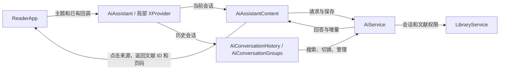
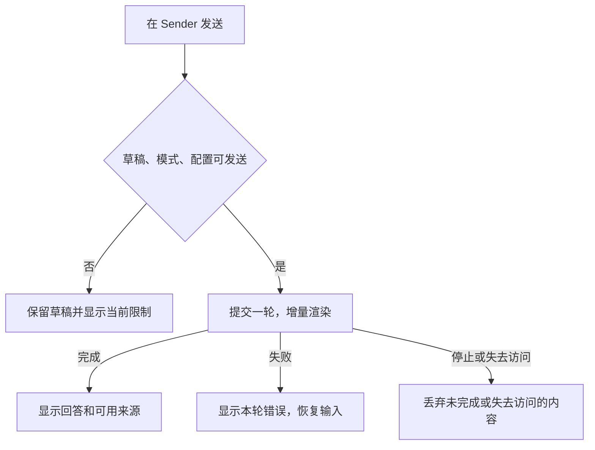
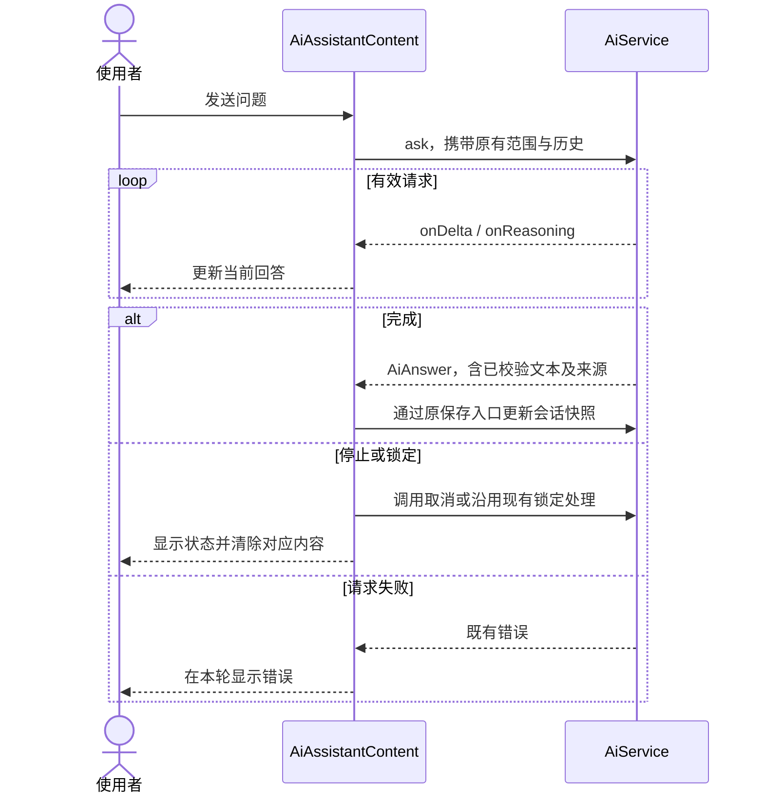

# SmartReader AI 研究助手界面改造

| Field | Value |
| --- | --- |
| Document | `2026-11-13-14-24-agent-ant-design-x-ui.md` |
| Template Version | `2` |
| Status | `Accepted` |
| Type | `Refactor` |
| Complexity | `Complex` |
| Complexity Drivers | 流式阅读位置、加密会话、历史会话排序与焦点、桌面窗口布局和三种主题 |
| Created | 2026-11-13 14:24 Asia/Shanghai |
| Updated | 2026-11-13 14:24 Asia/Shanghai |
| Owner | SmartReader 项目维护者 |
| Repository | SmartReader |
| Scope | 首页的 AI 研究助手工作区及其局部主题 |
| Source Requirement | 使用 Ant Design X 优化当前前端的 Agent 界面，先给方案 |
| Baseline Revision | `main` · `5c2a99a` |
| Amends | None |
| Supersedes | None |
| Depends On | None |
| Related Specs | [桌面文献库与 AI 既有设计](../../superpowers/plans/2026-10-11-research-library-ai.md#设计与边界) |
| Related Plans | [实施计划](../plan/2026-11-13-14-31-agent-ant-design-x-implementation.md) |

## 1. Summary

将 AI 研究助手改为左侧会话、中央对话、底部常驻输入。页头保留厂商、模型和设置入口。文献模式、检索范围和 PDF 入口放在输入框附近。以 Ant Design X 的 `Bubble`、`Sender`、`Welcome`、`Prompts` 和 `XProvider` 建立一致的对话样式。引用在所属回答下方展开，显示编号、标题、页码与摘录，并从当前入口打开 PDF。

## 2. Background and Current State

| Evidence ID | 类型 | 位置 | 观察 |
| --- | --- | --- | --- |
| EVD-001 | 源码 | [ReaderApp.tsx](../../../src/app/ReaderApp.tsx) 中的 `workspaceContent`、`openResearchPaper` | 首页 AI 入口挂载 `AiAssistant`。打开引用先检查文献访问权限，并复用 PDF 阅读器与定位入口。 |
| EVD-002 | 源码 | [AiAssistant.tsx](../../../src/ai/AiAssistant.tsx) 中的 `AiAssistantContent` 及 [aiWorkspace.css](../../../src/ai/aiWorkspace.css) | 提问、知识库与对话共用滚动容器。继续提问时通过 DOM 测量滚回输入框。宽屏回答与引用并排，长回答的正文宽度受引用栏影响。 |
| EVD-003 | 源码 | [AiConversationHistory.tsx](../../../src/ai/AiConversationHistory.tsx) 和 [AiConversationGroups.tsx](../../../src/ai/AiConversationGroups.tsx) | 历史搜索、置顶和分组共享现有服务。置顶和分组排序依赖指针捕获与上下方向键。删除确认追踪原焦点和滚动位置。 |
| EVD-004 | 历史验收 | [AI 会话管理原生 UI 复测](../../superpowers/reports/2026-10-23-ai-conversation-cua-validation.md#发现并修复) | 历史原生验收曾捕获会话元数据更新导致阅读位置丢失，以及长列表中的删除确认被滚动区遮挡。 |
| EVD-005 | 源码 | [AiSettings.tsx](../../../src/settings/AiSettings.tsx)、[styles.css](../../../src/app/styles.css)、[tauri.conf.json](../../../src-tauri/tauri.conf.json) | AI 设置与助手共用部分 CSS。应用已有亮色、暗色、护眼色。默认窗口为 1180 × 780，最小窗口为 860 × 560。 |

### 2.4 Evidence and current-chain map

| Entry/trigger | Current call chain | Data read/written | External dependency | Consumers | Evidence |
| --- | --- | --- | --- | --- | --- |
| 发送或停止 | `AiAssistantContent` → `AiService.ask` / `cancelAnswer` | 草稿、历史、文献范围、流式回答 | 所选模型，按配置调用 Embedding/Milvus | 消息区、会话保存 | EVD-002、[aiService.ts](../../../src/ai/aiService.ts) |
| 搜索或切换 | `AiConversationHistory` → `AiService` → `LibraryService` | 摘要、活动会话、本地会话快照 | Tauri 本地存储 | 历史列表、当前输入和对话 | EVD-003、[libraryService.ts](../../../src/library/libraryService.ts) |
| 查看来源 | `openSource` → `onOpenPaper` → `openResearchPaper` | 已验证引用的文献 ID 和页码 | 本地 PDF | 阅读器 | EVD-001、EVD-002 |

## 3. Goals and Non-goals

本期覆盖 AI 工作区的会话栏、正文、输入、空态、检索范围面板及提示状态。继续复用 AI 设置页、文献列表 `BookList`、现有 AI 服务、PDF 导入、阅读器和本地存储。Markdown 渲染、正文内引用识别、文件上传方式和 Agent 工具调用界面均留给独立需求。

## 4. Requirements and Acceptance Criteria

| ID | 要求 | 验收标准 | 来源 |
| --- | --- | --- | --- |
| REQ-001 | 采用 Ant Design X 构建主要聊天界面 | 进入 AI 工作区即可看到输入。向上阅读和流式生成时输入区始终可达。 | 用户要求及 EVD-002 |
| REQ-002 | 保留文献问答所需的上下文 | 发送前可见模式及文献范围。完成后可在回答下找到来源，并跳到对应 PDF 页。 | EVD-001、EVD-002 |
| REQ-003 | 压缩会话列表行的操作密度 | 搜索、切换和新建入口可达。行内菜单支持重命名、移动分组、置顶和删除。保留两种排序方式。 | EVD-003、EVD-004 |
| REQ-004 | 保持请求、会话及访问状态的既有语义 | 原草稿、模型选择和历史可恢复。取消或锁定后的迟到内容不渲染。搜索、恢复、保存及模型错误有可见反馈。 | EVD-002 至 EVD-004 |
| REQ-005 | 适配 SmartReader 外观与窗口 | 亮色、暗色、护眼色均可读。最小窗口可操作发送、停止、会话和文献范围。 | EVD-005 |

### 4.1 Scenario matrix

| Scenario | 触发与条件 | 主流程或异常 | 状态影响及验收 |
| --- | --- | --- | --- |
| 首轮及追问 | 厂商、模型、密钥可用 | 有文献时按选定范围发送。空库按既有规则进入直接对话。快捷问题只填草稿。 | 文献范围为空或配置缺失时给出具体指引。可达的发送按钮只提交一次。 |
| 流式及取消 | 已发送，模型返回增量 | 原有增量进入回答。向上阅读暂停跟随，点击「回到最新回答」恢复。停止后移除未完成轮次。 | 已完成轮次保留，迟到内容不出现，失败信息归属当前轮次。 |
| 加密与恢复 | 文献锁定、会话正在恢复或切换 | 显示已有锁定、加载和重试状态。恢复完成后显示对应会话。 | 锁定内容及摘录不呈现，保存失败可重试。 |
| 会话整理 | 修改置顶、分组或删除 | 使用现有命令和确认流程。搜索继续命中已折叠组。 | 元数据操作不重挂聊天。取消删除恢复焦点，失败时保留待处理对象。 |
| 小窗口及切换主题 | 缩小内容区或切换主题 | 通过「历史会话」打开历史面板，文献范围独立展开，输入区常驻。 | 弹层保持同主题，键盘可关闭并返回原触发控件。 |

### 4.2 Use-case analysis

| Actor ID | 角色 | 入口和权限 |
| --- | --- | --- |
| ACTOR-001 | SmartReader 研究助手使用者 | 首页 AI 入口，受当前会话及文献访问权限约束 |
| ACTOR-002 | 已配置的模型服务 | 由现有 `AiService` 调用，依赖已解锁凭据 |

| ID | Use case/goal | 参与者 | 触发和前提 | 成功结果 | 失败与结束状态 | 需求 | 测试 |
| --- | --- | --- | --- | --- | --- | --- | --- |
| UC-001 | 提问并追问 | ACTOR-001、ACTOR-002 | 在底部输入，配置及模式就绪 | 阅读流式结果并继续提问 | 缺配置时给出入口，错误留在本轮，取消清除未完成轮次 | REQ-001、REQ-004、REQ-005 | TEST-001、TEST-002、TEST-005 |
| UC-002 | 选择文献并查阅原文 | ACTOR-001、ACTOR-002 | 选择范围或点击回答来源，文献当前可访问 | 检索选定范围并打开引用页 | 禁止空范围发送和打开锁定文献，现有权限规则继续生效 | REQ-002、REQ-004 | TEST-003、TEST-004 |
| UC-003 | 找回和整理历史 | ACTOR-001 | 新建、搜索、切换或行菜单，服务已恢复 | 选中会话恢复自己的草稿、模型、上下文及历史 | 搜索、保存失败有反馈，删除取消恢复焦点，锁定会话显示锁定摘要 | REQ-003、REQ-004、REQ-005 | TEST-004、TEST-005 |

## 5. Constraints, Assumptions, and Decisions

- `DEC-001` 用户指定使用 Ant Design X，当前阶段交付方案供评审。
- `ASM-001` 将 Agent 界面理解为首页的「AI 研究助手」。它是 `AiAssistant` 的生产入口，AI 设置可从该处打开。
- `ASM-002` 常驻输入、折叠引用及小窗历史面板属于本方案的推荐交互。宽窗版心约 820 px，历史栏约 240 px，依据当前 260 px 历史栏和 1180 px 默认窗口选取。窄窗切换以实际工作区宽度和原生验收结果调整。
- 无阻塞评审的业务决策。依赖版本在方案中给出候选组合，锁定前以安装、构建和 WebView 验证为准。

## 6. Project Technology Context

[package.json](../../../package.json) 声明 React / React DOM 18.3.1、TypeScript 6.0.3、Vite 8.0.16、Vitest 4.1.9，仓库使用 Bun 锁文件。桌面端为 Tauri 2。候选 `@ant-design/x@2.10.0` 发布包要求 `antd ^6.1.1` 与 React / React DOM `>=18.0.0`，因此 React 18.3.1 满足声明的约束。选定版本后复查实际组件 API 和构建产物。Java 层 N/A，受影响的界面为 TypeScript/React。 [Ant Design X 介绍](https://ant-design-x.antgroup.com/components/introduce-cn/) · [npm 发布元数据](https://registry.npmjs.org/@ant-design%2Fx/2.10.0)

## 7. Architecture Design

### 7.1 System Architecture Design

`ReaderApp` 传入当前主题与既有回调。局部 `XProvider` 提供组件主题，`AiAssistantContent` 继续拥有消息、草稿、业务请求和会话挂载边界。



### 7.2 High-Level Design



#### 7.2.2 High-level decision and quality matrix

| Concern/use case | 设计 | 验证 |
| --- | --- | --- |
| 连续阅读 | 对话容器独立滚动，由现有跟随规则管理；输入栏作为同级常驻区域。 | 流式向上阅读、回到底部、短窗口下长答案及长草稿 |
| 访问与持久化 | 保留 `answerEpoch`、请求代次、`activeConversationId`、锁定状态和原保存入口。 | 取消、锁定解锁、切换、重启恢复和迟到响应 |
| 主题和首屏 | 主题作用域限于工作区。必要时在入口按需加载依赖，构建后检查真实 chunk。 | 首次进入、三主题、窗口缩放和下拉菜单 |

### 7.3 Detailed Design

| 区域 | 设计及数据来源 |
| --- | --- |
| 对话 | 使用单条 `Bubble` 渲染既有 `AiChatMessage`，`id` 作为 key。用户气泡浅底靠右，助手正文低边框靠左。模型、检索方式置于次级行。正文及思考内容继续作为纯文本。无首个增量时显示现有等待文案。 |
| 输入 | `Sender` 以 `visibleDraft` 受控，发送调用同一条 `submit` 业务路径，保留 4000 字符限制。通过输入组件或键盘回调保留 Enter 换行与中文输入法选词，通过可聚焦按钮发送。发送受 `busy`、`questionReady` 和去空白后是否为空控制。停止动作仅绑定现有 `cancel`，向量构建仍有独立取消入口。「继续提问」聚焦底部输入，不移动正文滚动位置。 |
| 文献范围 | 输入区显示「文献问答 / 直接对话」和当前范围，例如「已选 3 篇」。点击范围打开工作区内的文献侧面板，复用 `BookList`、现有搜索、多选、PDF 导入、移除、重新加入和索引操作。无可检索项时保留现有提示及禁用规则。 |
| 引用与思考 | 回答下方使用可键盘展开的区域。引用摘要显示数量，展开后每条显示 `label`、`title`、`page`、`excerpt`，按钮调用 `openSource`。模型已有 `reasoning` 时才显示「模型思考过程」。以原生 `details` 和按钮保留折叠与打开原文的键盘语义，外观与 Ant Design X 的 `Think`、`Sources` 对齐。 |
| 会话列表 | 保留列表节点和已有排序、搜索、选中及服务逻辑。用紧凑列表、当前项高亮与行内菜单集中重命名、移动、置顶、删除。保持置顶排序手柄，分组管理仍支持折叠与顺序调整。删除确认沿用现有二次确认及焦点恢复。 |
| 空态和提示 | 空会话用 `Welcome` 和少量 `Prompts`。文献模式示例「总结所选文献的主要结论」，直接模式示例「帮我梳理这个研究问题」。草稿为空且可编辑时显示快捷问题，点击后填入草稿并聚焦。无密钥、模型失效、没有可用文献时优先显示对应指引。错误靠近触发区域，重要状态保留 `alert` / `status`。 |

#### 7.3.2 Critical-path Mermaid swimlane



#### 7.3.6 Conclusion evidence chain

| Conclusion | 证据与约束 | 设计与取舍 | 验证 |
| --- | --- | --- | --- |
| 正文独立滚动 | EVD-002 共用滚动区，EVD-004 原生记录过位置丢失。 | 使用单条 `Bubble`，避免 `Bubble.List` 再管理一层滚动。 | TEST-002、TEST-005 |
| 局部组件化 | EVD-003 历史列表的拖拽、焦点依赖现有结构，EVD-005 CSS 被设置页共享。 | 保留历史骨架，定制行与菜单。Ant Design X 主要用于对话区并局部配置主题。 | TEST-004、TEST-005 |

## 8. Package Structure and Code File Tree

| 位置 | 拟议改动 |
| --- | --- |
| `src/app/ReaderApp.tsx` | 为 AI 入口传入已生效主题。构建确有主包增量时在同一入口按需加载。 |
| `src/ai/AiAssistant.tsx` | 接入局部 Provider、对话、输入和空态，调整三个区域的布局。知识库原有控制迁至可独立打开的面板。 |
| `src/ai/AiConversationHistory.tsx`、`AiConversationGroups.tsx` | 紧凑列表、行菜单、窄窗历史入口及焦点处理。 |
| `src/ai/aiWorkspace.css` | 助手样式按工作区根节点约束，保留设置页引用的现有选择器。 |
| `package.json`、`bun.lock` | 实施时锁定经验证的 Ant Design X 和 antd 组合。 |

## 9. Interface Definitions

### 9.1 Interface Inventory

N/A，本次界面设计无新增或变更的 HTTP、Tauri 命令或业务服务契约。受控组件回调映射见 §7.3。

### 9.2 Per-interface Detailed Contracts

继续调用 [aiService.ts](../../../src/ai/aiService.ts) 的 `ask(question, options)`、`cancelAnswer()`、`saveAssistantSession(session)` 以及现有历史命令。输入与错误显示见 §7.3。来源继续按 [ReaderApp.tsx](../../../src/app/ReaderApp.tsx) 的 `openResearchPaper(id, page?)` 语义打开。

## 10. POJO and Data Model Design

复用 [libraryModels.ts](../../../src/library/libraryModels.ts) 中的 `AiChatMessage`、`AiSource`、`AiAssistantSession`、`AiConversationSummary` 及 `AiConversationGroup`。工作区内侧栏开合是展示状态，会话内容和关联数据仍由现有服务维护。历史选择与列表过滤保持现有规则。

## 11. Database Design

### 11.1 Table Inventory

N/A，展示层无直接数据库访问，现有会话服务通过 `LibraryStorage` 保存快照。存储背景见 [007_research_library.sql](../../../src-tauri/src/migrations/007_research_library.sql) 中的 `research_library_state`。

### 11.2 Per-table Detailed Design

N/A，字段、索引、写入路径和迁移均无改动。会话保存仍使用当前快照 revision 校验及加密方式。

### 11.3 Entity-relationship diagram

N/A，本方案没有数据库表关系或访问方式的变更。

## 12. Frontend Page Design

```text
宽窗
┌────────────────┬───────────────────────────────────────────────┐
│ ＋ 新建对话     │ AI 研究助手        厂商 · 模型       AI 设置   │
│ 搜索历史        ├───────────────────────────────────────────────┤
│ 分组筛选 · 管理 │                           用户问题             │
│ 置顶会话        │ 助手回答                                      │
│ 会话标题     ⋯  │   模型思考过程 ▸                               │
│                │   3 条来源 ▸    （正文区独立滚动）              │
│                ├───────────────────────────────────────────────┤
│                │ 文献问答 · 已选 3 篇    ＋ PDF                   │
│                │ 输入你的研究问题…                    发送/停止  │
└────────────────┴───────────────────────────────────────────────┘
```

- 窄窗口将历史移入从页头打开的侧面板。输入区的模式、范围、发送和停止允许换行，限制长草稿的可见高度。知识库面板拥有自己的滚动区，关闭后恢复焦点。
- 对话版心居中，正文建议 14–15 px、行高约 1.7。优先用现有主题中的背景、文本、边框和强调色，突出当前会话、发送按钮和引用页码。
- 在 `XProvider` 内映射现有 `--sr-*` 对应的主题值。参与 Ant Design 色阶计算的 Token 使用解析后的具体颜色，纯样式位置继续引用 CSS 变量。组件定制使用公开语义化样式接口。弹层按容器实际裁切情况布置，在亮色、暗色、护眼色下验证颜色与焦点对比。 [XProvider](https://ant-design-x.antgroup.com/components/x-provider) · [Bubble](https://ant-design-x.antgroup.com/components/bubble-cn) · [Sender](https://ant-design-x.antgroup.com/components/sender-cn)

## 13. Design Patterns and Architecture Principles

通过组件组合接入受控视图，复用 `AiService` 的状态与动作。历史节点保留现有键盘和指针行为，重排可见入口时避免改变实际操作顺序。文献来源仍由 `AiService.ask` 校验，UI 负责展示已经返回的引用。

## 14. Test Design

| ID | 实施后检查 |
| --- | --- |
| TEST-001 | 复用 `AiAssistant.test.tsx` 覆盖缺配置、发送约束、两种问答模式、4000 字符边界、中文输入法、快捷问题填入草稿及停止按钮。 |
| TEST-002 | 检查长回答流式更新、向上阅读、回到最新、继续提问焦点、取消后迟到响应与纯文本渲染。 |
| TEST-003 | 复用 `knowledgeMembership.test.tsx` 和引用跳页测试，覆盖多选、空范围、移除、重加、锁定以及原生 PDF 入口。 |
| TEST-004 | 复用 `AiConversationHistory.test.tsx` 和 `aiSessionPersistence.test.tsx`，覆盖搜索折叠组、置顶和分组排序、删除确认焦点、元数据保存及切换和重启。 |
| TEST-005 | 运行 typecheck、针对性测试和 Vite 构建。用隔离 Tauri 应用和现有本机模拟模型检查默认/最小窗口、125% 缩放、三主题、弹层和焦点，再比较首页与 AI 路由构建体积。 |

## 15. Non-functional and Cross-cutting Design

保留现有发送范围与隐私提示，局部主题配置使用本地资源。构建检查 `antd`、`@ant-design/x` 及传递依赖对初始 JS 的增量，特别是未使用的图表和语法高亮代码是否进入入口 chunk。

## 16. Compatibility, Migration, Rollout, and Rollback

沿用既有 `LibrarySnapshot` 和会话字段，兼容原有草稿、模型与加密记录。前端改造可随界面提交回退，依赖与锁文件一并回退。用改造前生成的测试快照验证恢复。

## 17. Alternatives and Decisions

历史列表首期沿用已有 HTML 与操作语义。Ant Design X 的 `Conversations` 提供受控选中、操作菜单和分组展示。迁移整个历史列表需要重接 Tauri 中的置顶拖拽、分组排序、搜索跨折叠分组、删除焦点恢复，因此本期直接复用现有历史逻辑，调整视觉层级。引用与思考采用同一原则，参考 `Sources` 和 `Think` 的样式，用现有可键盘操作的原生结构承载本地 PDF 跳转与折叠。 [Conversations](https://ant-design-x.antgroup.com/components/conversations-cn) · [Sources](https://ant-design-x.antgroup.com/components/sources) · [组件总览](https://ant-design-x.antgroup.com/components/overview-cn)

## 18. Risks and Open Questions

最小窗口、中文输入法、气泡长文本换行与局部主题在真实 WebView 中待实施验证。npm peer 声明已核对。依赖安装、产物大小和原生运行仍待验证。

## 19. Traceability Matrix

| Requirement | Use case | Design | Tests |
| --- | --- | --- | --- |
| REQ-001 | UC-001 | §7.3、§12 | TEST-001、TEST-002、TEST-005 |
| REQ-002 | UC-002 | §7.3 | TEST-003 |
| REQ-003 | UC-003 | §7.3、§17 | TEST-004、TEST-005 |
| REQ-004 | UC-001、UC-002、UC-003 | §7.1、§7.3、§16 | TEST-002、TEST-003、TEST-004 |
| REQ-005 | UC-001、UC-003 | §12、§15 | TEST-005 |

## 20. Review and Acceptance

本稿依据当前代码、历史原生验收报告、组件文档与 npm 发布包整理。方案验收看工作区结构、Ant Design X 采用范围和既有交互的保留。当前交付为待评审设计，验证范围是仓库静态检查与文档校验。

**PASS — Ready for user review**
